<p align="center">
  <picture>
    <source media="(prefers-color-scheme: dark)" srcset="docs/assets/banner-dark.png">
    <source media="(prefers-color-scheme: light)" srcset="docs/assets/banner-light.png">
    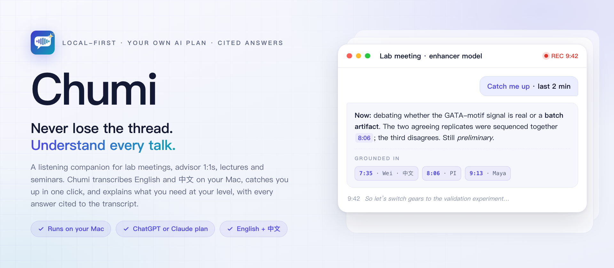
  </picture>
</p>

<p align="center">
  
  
  
  
  
  <a href="LICENSE"></a>
</p>

<p align="center"><b>English</b> · <a href="README.zh-CN.md">简体中文</a></p>

<p align="center">
  <a href="docs/assets/chumi-promo-1.5x.mp4">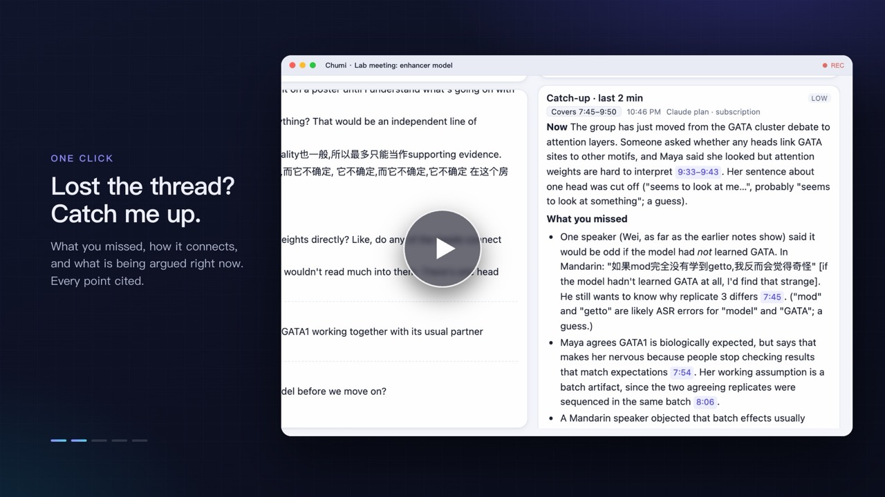</a><br>
  <sub>▶ <a href="docs/assets/chumi-promo-1.5x.mp4">Watch the 36-second video</a> · <a href="docs/assets/chumi-promo-2x.mp4">27-second cut</a> · <a href="docs/assets/chumi-promo.mp4">full 54 s</a> · <a href="docs/assets/chumi-promo-zh-1.5x.mp4">中文版</a></sub>
</p>

---

**Chumi is a listening companion for academic conversations that carries what was decided into your coding agent.** It transcribes lab meetings, advisor 1:1s, lectures and seminars on your Mac, in English, Mandarin, or both at once. While the talk goes on, it tells you where the discussion is, catches you up when you drift, and explains unfamiliar methods and terms at your level. Every answer is cited back to the moment it came from.

When the meeting ends, Chumi doesn't stop at notes. You review a handoff of what was decided, and Claude Code, Codex, opencode or Qwen Code picks it up in your project, reading the original evidence for itself. In the next meeting, Chumi can look up what those agents already did. It runs on your ChatGPT or Claude subscription, a local model server, or a compatible API, and audio never leaves your Mac.

## The agent loop

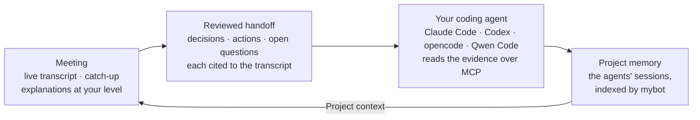

1. **Listen and understand.** During the meeting, Chumi transcribes on your Mac, catches you up when you drift, and explains terms at your level.
2. **Review a handoff.** Afterwards it drafts the decisions, actions and open questions, each cited to the transcript and labelled *agreed in the meeting*, *suggested, not agreed* or *proposed by Chumi*. You edit, confirm or reject every item. Only confirmed work is handed on.
3. **Your agent continues.** **Continue in Claude Code** (or Codex, opencode, Qwen Code) opens the agent in the project folder with the confirmed work. Through Chumi's local, read-only MCP server it reads the handoff, the original transcript lines and the captured slides, then proposes a plan and waits for your go-ahead.
4. **The next meeting remembers.** Turn on **Project context** in the Ask box, and your questions also search the project's earlier Claude Code and Codex sessions through [mybot](https://github.com/jzhoulab/mybot). Answers cite them as `[P1]`, `[P2]`, so you hear what the agents already tried before deciding again.

<p align="center">
  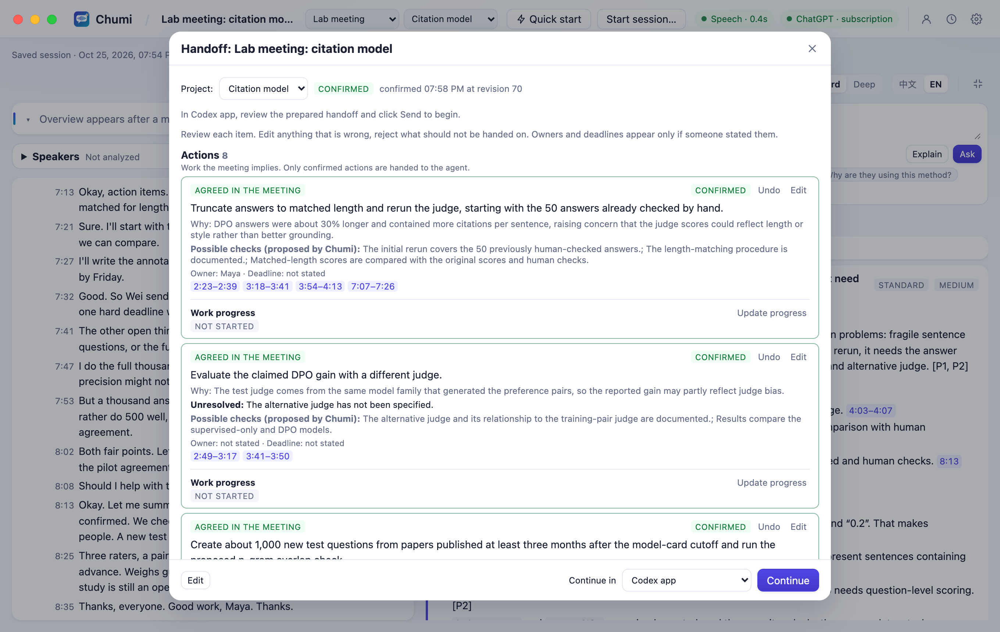
</p>

<p align="center">
  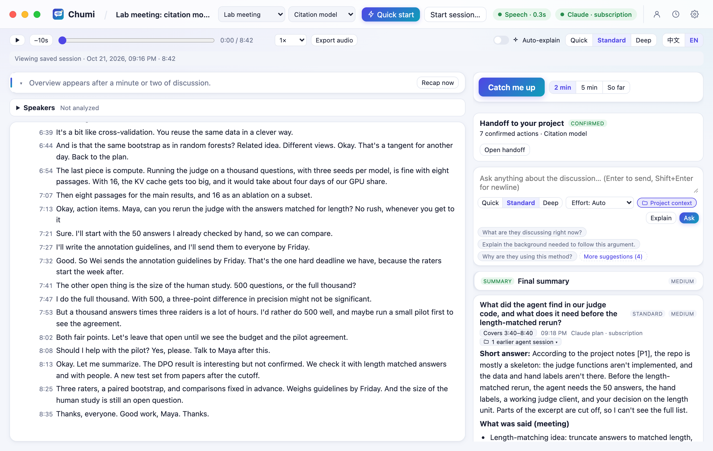
</p>

<sub>Both from a real run on the sample meeting: real local transcription and real Claude answers. The project-context answer draws on the Claude Code and Codex sessions that continued an earlier handoff of this sample project.</sub>

## How Chumi differs from a transcription app

| | Typical meeting transcription app | Chumi |
|---|---|---|
| **During the meeting** | A live transcript to scroll through | Catches you up, explains terms at your level, and reads the slides on screen |
| **When it ends** | A summary and action items for people to read | A handoff you review, which your coding agent then continues in the project |
| **Evidence** | The summary becomes the record | Every claim cites a moment; agents fetch the original lines and slides themselves |
| **What the AI added** | Mixed into the notes | Kept apart: what was said, background Chumi added, and interpretation |
| **Who decides** | The AI's action items are the output | Items are labelled agreed, suggested or proposed by Chumi; only what you confirm becomes work |
| **Across meetings** | One set of notes per meeting | Meetings and agent sessions in one memory, which the next meeting can draw on |
| **Audio and cost** | Often processed in the vendor's cloud, on a separate subscription | Speech recognized on your Mac; AI from the ChatGPT or Claude plan you already have, or a local model |

## Highlights

- **Meetings that turn into work.** A reviewed handoff goes to Claude Code, Codex, opencode or Qwen Code in your project folder, with the original evidence one tool call away. No pasting the transcript, no briefing the agent from scratch.
- **The next meeting knows what the agents did.** With **Project context** on, answers draw on the project's earlier agent sessions and cite them, next to what was said in the room.
- **Catch up in one click.** You drifted off, or the speaker skipped ahead. **Catch me up** tells you what is being discussed now, what you missed, how it connects to earlier points, and which question is on the table. Every answer states the exact stretch of transcript it covers, and it stays put while the meeting goes on.
- **Explanations pitched to you.** Select a phrase and get the background at the right level. Chumi keeps a per-domain profile: it won't explain transformers to an ML person, and it won't assume you know a wet-lab assay. Pick **Quick, Standard or Deep**, and, on supported providers, choose how hard the model thinks, from **Low to Max**. Compatible models use their server's reasoning defaults.
- **It keeps what was said apart from what it adds.** Answers separate *what the speakers said*, *background added by Chumi*, and *interpretation and uncertainty*. Every claim cites a clickable `[m:ss]` that jumps to the supporting lines. If a speaker points at a slide Chumi can't see, it says so instead of guessing.
- **It sees the slides too.** Capture the Zoom share, the lecture video or the slide deck. Chumi keeps one picture per slide and can show it to the model, so *"explain this figure"* works.
- **Bilingual by design.** Transcribes English, Mandarin, and Mandarin with English technical terms. Explains in **中文** (keeping English terms) or **English**, switchable at any time. The interface itself comes in English and 中文 too.
- **Summaries you can trust.** Summaries are shaped for lab meetings, advisor 1:1s, lectures or WIP talks. Rename or add your own types in **Settings → Session types**, each with the summary style it should use. Preliminary results stay preliminary, disagreements are kept, and owners or deadlines appear only if someone actually said them.
- **Uses the subscription you already pay for.** ChatGPT (through Codex) or Claude (through Claude Code), with quota shown when the provider reports it. Chumi **never** switches to a paid API on its own, and blocks purchased ChatGPT credits unless you allow them. You can also explicitly select a local model server or compatible API; remaining API quota is unknown.
- **Private and crash-safe.** Speech recognition runs locally with whisper.cpp, so audio never leaves the Mac. Transcript lines are saved as they arrive. After a crash, the session reopens with a gap marker and can be resumed.
- **One keystroke when a talk starts.** Press **⌃⌥⌘L** from any app to start listening. Press again to pause.

## See it in action

**Lost the thread? Catch me up.** Here's a live lab meeting with a running overview and transcript. The catch-up covers exactly the last two minutes, with every point cited to the transcript:

<p align="center">
  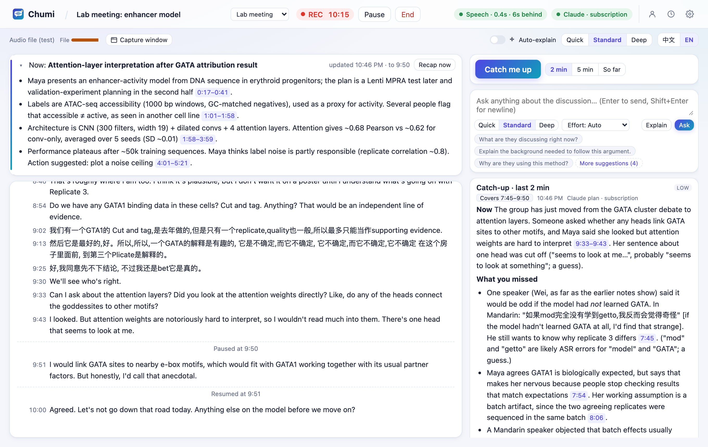
</p>

**Ask about the slide on screen.** A captured slide goes with the question, and the answer weighs it against what was actually said. Here it notices that some of the slide's numbers differ from what was said aloud, so it treats the slide as a draft:

<p align="center">
  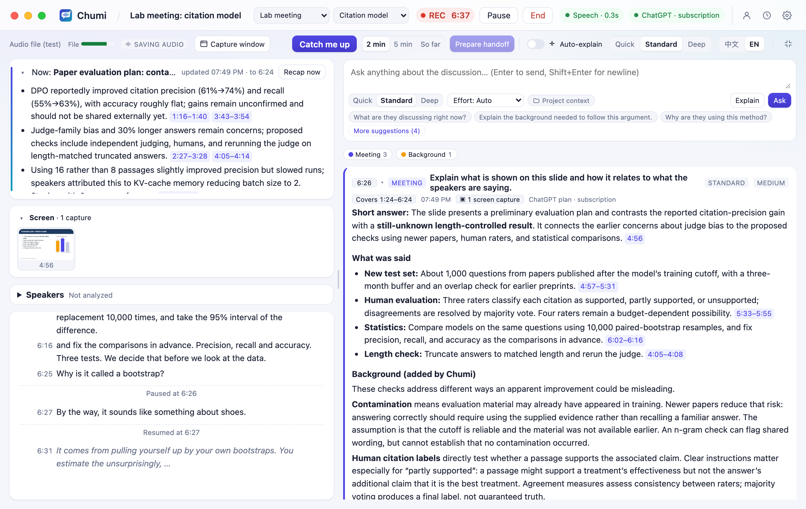
</p>

**Explanations pitched to you.** Select *negative binomial* in the transcript and get the intuition, how it was used in this discussion, and why it matters. All of it is pitched to your statistics level, in English or Chinese:

<p align="center">
  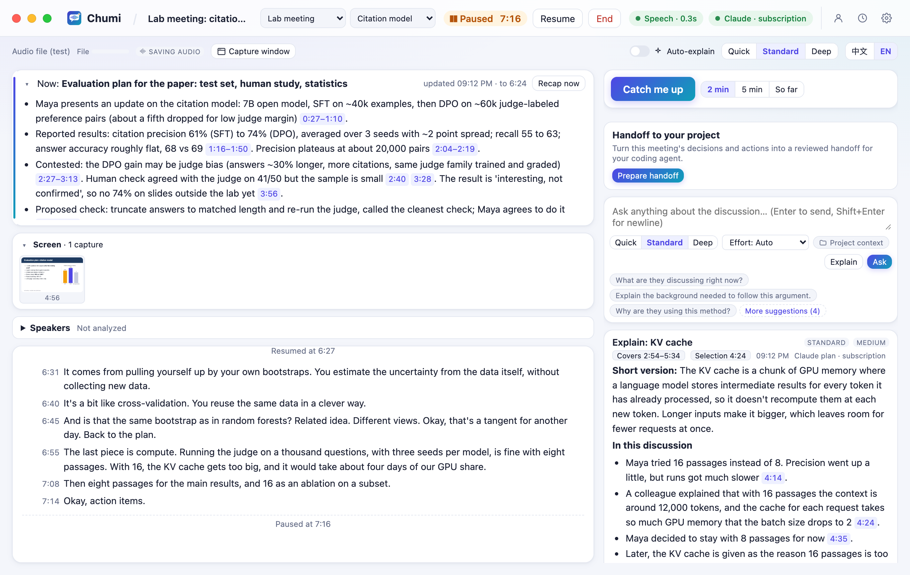
</p>

**A structured summary when the meeting ends.** It has sections for research question, methods, findings (labelled established, preliminary or contested), disagreements, open questions and action items, all cited back to the transcript. Dark mode included:

<p align="center">
  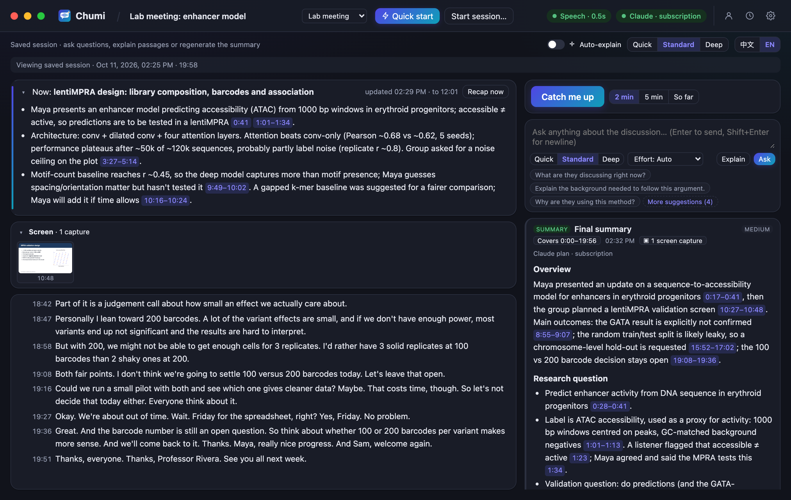
</p>

**A speech model that fits your Mac.** Settings → Transcription lists seven models from Tiny to Large v3, recommends one for your hardware, and tests the current model's speed and accuracy:

<p align="center">
  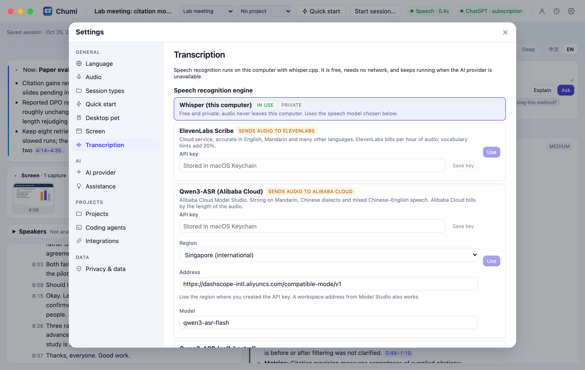
</p>

**Start in one click.** The home screen offers quick start, presets for in-person, online and hybrid conversations, your recent sessions, and your knowledge profile at a glance:

<p align="center">
  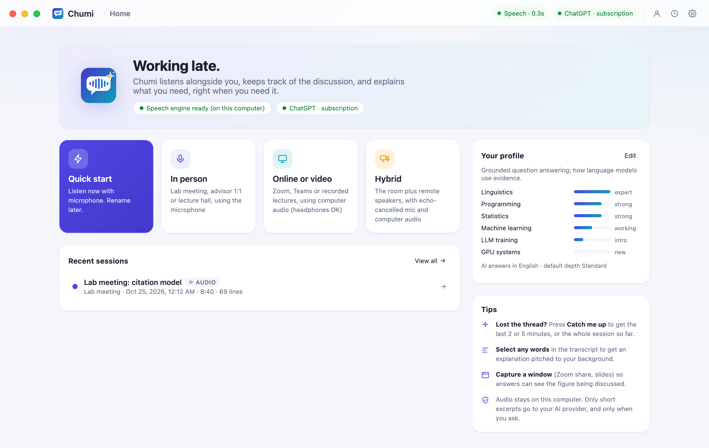
</p>

<sub>All screenshots come from a real run (real local transcription, real Claude answers) on a synthetic, all-English sample meeting in <code>samples/lab-meeting-en</code>: a written script with fictional people, voiced by macOS text-to-speech, and a fictional profile. Nothing comes from real meetings. To regenerate them, run <code>node scripts/demo-shoot.ts</code>.</sub>

## Set up the agent loop

**iPhone prototype:** a native SwiftUI project is available at [`ios/Chumi.xcodeproj`](ios/Chumi.xcodeproj), with local recording, on-device Apple Speech transcription, and paired Mac AI assistance. Full Xcode is required; iOS compilation and device validation are pending. See the [iPhone development guide](ios/README.md) for setup, pairing, and limitations.

1. **Projects.** Assign a meeting to a project: the folder you work in. Pick it when you start, or later in the top bar. Nothing is assigned automatically.
2. **Coding agents.** Connect each agent once in **Settings → Coding agents**. Chumi registers its read-only MCP server with the agent, and **Test a real agent read** confirms the agent can reach Chumi. Claude Code and Codex have their own **Continue** buttons; opencode and Qwen Code are in the **Continue in another agent…** menu.
3. **Project context (optional).** Run [mybot](https://github.com/jzhoulab/mybot) locally and check its address in **Settings → Integrations** (default `http://127.0.0.1:8788`). Nothing is searched until you turn **Project context** on for a meeting.

If the meeting changes after you confirm, for example a regenerated summary or a resumed recording, Chumi and the agent both see that the handoff may need another look. The agent works under its own permission prompts, and Chumi never marks the work done. Setup, the MCP tools and the privacy model are in [docs/agents.md](docs/agents.md); project context is in [docs/mybot.md](docs/mybot.md#project-context-in-questions).

## Works with mybot

[**mybot**](https://github.com/jzhoulab/mybot) unifies your Claude Code and Codex conversations into one local, searchable memory. It works in both directions with Chumi: during a meeting, **Project context** asks mybot what your agents already did, and with Chumi's export turned on, **your meetings join that memory too**. Ask mybot *"what did my advisor ask me to rerun last week?"* or *"when did we decide on 200 barcodes per variant, and who was unsure?"*, and it answers with the date and a link to the exact moment in the meeting.

- In Chumi, go to **Settings → Integrations** and turn on *Export finished sessions for mybot*.
- In mybot, run `bash integrations/mybot/install.sh ~/Code/mybot` once, then add `chumi` to `TRAJECTORY_SOURCES`.
- Meetings are **owner-only by default** (`visibility: private`), because they contain other people's words. Sharing with teammates is a separate opt-in.

Setup, the export format and the privacy model are in [docs/mybot.md](docs/mybot.md).

## Optional speaker labels

Run `npm run setup:speakers`, then enable **Settings → Transcription → Speaker labels** before recording. After the meeting ends, a local model groups voices as A/B/C. Open **Speakers** above the transcript to name them; click a line's label to correct it. Current labels accompany AI context, exports, and Claude Code/Codex evidence. Earlier summaries and reviewed handoffs are marked stale after corrections.

Analysis uses temporary local audio, deleted on completion, failure, cancellation, or app restart. **Save raw audio** keeps the captured takes for reruns. Labels are estimates within a meeting and audio source; mixed speech remains uncertain. See [the workflow and testing notes](docs/speaker-diarization.md) and [model setup](docs/speaker-models.md).

## Quick start

**You need** a Mac with Apple Silicon on macOS 14.4 or later, and a ChatGPT or Claude subscription. Without a subscription, a Mac with 16 GB of memory or more can run a free local model. Nothing else has to be installed first.

**Windows (desktop preview):** an Electron window, microphone/computer-audio capture and hybrid meetings are implemented. The installer bundles Node, the speech engine and Codex; users need no .NET or build commands. First use offers an in-app model download and ChatGPT browser sign-in. The current x64 build has passed real capture, transcription, live assistance, summary and MCP handoff checks on Windows 11. Other Windows 10/11 machines still need release qualification. See [docs/windows.md](docs/windows.md).

Open Terminal and paste:

```bash
curl -fsSL https://raw.githubusercontent.com/FakeEnd/chumi/main/scripts/install.sh | bash
```

It downloads Chumi into `~/Chumi`, and the guided setup takes about 5 to 15 minutes:

1. **Checks your Mac** and offers to install anything missing: the Xcode Command Line Tools, Homebrew, Node.js 24. It asks first.
2. **Installs local speech recognition:** whisper.cpp, plus the speech model that suits your Mac (Large v3 Turbo, about 875 MB, on Apple Silicon with 16 GB or more).
3. **Builds Chumi.app** on your Mac.
4. **Helps you connect an AI:** ChatGPT through Codex, Claude through Claude Code, or a local model. Your sign-in stays with the official tool; Chumi never sees it.
5. **Checks everything** and opens Chumi.

On first launch, the **Get Chumi ready** checklist on Home walks you through what is left: the AI sign-in, your background (explanations are pitched to it) and microphone access. Then click **⚡ Quick start**, or press **⌃⌥⌘L** from any app. You can also run Chumi in a browser: `npm start`, then open http://127.0.0.1:4777.

Prefer to install by hand? Run `git clone https://github.com/FakeEnd/chumi.git && cd chumi && bash scripts/setup.sh`. **[The install guide](docs/install.md)** has the options (including `--mirror` for faster downloads in mainland China), permissions, troubleshooting and uninstalling. `npm run doctor` checks an existing install and prints the fix for anything missing.

### Other models: local or API

Presets cover **Qwen, Doubao, MiniMax, GLM, Ollama, LM Studio**, and a **custom compatible API**. These use a compatible Chat Completions endpoint; a preset supplies a starting URL, not a model or subscription entitlement.

1. Open **Settings → AI provider** and select **Other models: local or API**. Choose **Ollama** or **LM Studio** to automatically read the local service's model list, then select a model. No model ID is needed to discover models. If the service cannot be reached or lists no models, follow the installation, startup, or download guidance and click **Refresh models**. Remote API presets still use the exact model or deployment ID from the provider console.
2. Explicitly enable the profile, including permission to charge your provider account for a remote API, then **Save model settings**. Each preset keeps its own profile. Save or discard edits before managing a key or testing.
3. Save an API key if needed. Keys live in **macOS Keychain**, separately for each preset and endpoint. Optionally click **Test with a short generation**: it sends synthetic text, no meeting content, and can incur a charge.
4. Once saved, the selected model is used for new requests. Discovery only reads model metadata; it does not generate answers, download models, or send meeting content. Connection URLs, optional local API keys, and advanced model options are available in expandable sections.

Before downloading, the local presets show **models for this computer** using the detected chip, total memory, home-volume disk space, and selected transcription model. Compare approximate download sizes and estimated runtime memory for specific Qwen3 quantizations. Recommendations reserve room for macOS, other apps, and Chumi transcription; longer context lengths increase the estimate. The context selector only changes the estimate, so configure the same context length in your model manager. This is capacity guidance, not a speed benchmark or a guarantee. Recommendations work before the model service is installed or started. See [estimation assumptions and sources](docs/local-model-advice.md).

Images are off by default; enable them only when the model and endpoint support them, and also enable **Send screen captures** in Screen settings. Structured output defaults to prompt-only; select JSON object/schema mode only if supported. Chumi does not send its reasoning-effort controls to compatible endpoints.

Install and start Ollama or LM Studio first, then click **Download recommended model** in Chumi. Downloads show progress, continue while Settings is closed, and refresh the model list on completion. Ollama supports cancellation and retry in Chumi; LM Studio 0.4+ uses its native download API, with pause/cancel managed in LM Studio. If its model is not listed after downloading, enable Just-In-Time loading or load it in Developer. Downloading does not automatically select or load the model. Choose it from the list and save your settings.

Configure enough context capacity for meeting excerpts, notes and answers; Chumi does not set the server's context window. A local server can route externally, so check its configuration. Compatible inference requests have no automatic retry or provider fallback. API quota remains unknown; check your provider's billing console and terms rather than assuming a chat subscription includes API access.

## Features

**Listening**
- Microphone for in-person conversations, computer audio for Zoom, Teams or recorded lectures (headphones are fine), or both for hybrid meetings, with echo cancellation and duplicate filtering.
- Local whisper.cpp on the Metal GPU, about 0.3 s per utterance with Large v3 Turbo. Grey partial text is revised in place, never duplicated.
- Seven speech models, from Tiny (31 MB) for older Macs to Large v3 (1 GB). Settings → Transcription recommends one for your hardware, downloads and deletes models, and measures the current model's speed and accuracy.
- English, Mandarin and code-switching. Whisper sometimes writes Mandarin in Traditional characters; Chumi converts them to Simplified unless you turn that off. Vocabulary hints improve spelling of jargon and names.
- Pause, resume, a quick-start shortcut, level meters, and clear permission guidance.

**Understanding**
- Catch me up over the last 2 minutes, the last 5 minutes, or the whole session so far.
- Questions about the selected passage, the surrounding discussion and relevant earlier passages.
- Explanation depth (Quick, Standard, Deep) for each question; reasoning effort (Auto, Low, Medium, High, Extra high, Max) on supported providers. Compatible models use server defaults. Neither changes your saved profile.
- Optional auto-explain cards with a cooldown and an interruption cap. Turning it off drops late results.
- A running overview and topic timeline, updated at pauses and topic changes.
- Window capture (ScreenCaptureKit) with one picture kept per slide, and *Ask about this slide*.

**Continuing the work**
- A handoff drafted from the transcript: decisions, actions and open questions, each cited and labelled agreed, suggested or proposed by Chumi. You review every item before anything is handed on.
- **Continue in** Claude Code, Codex, opencode or Qwen Code: the agent opens in the project folder with the confirmed work, and reads the handoff, original passages and slides through Chumi's read-only MCP server.
- Freshness: if the meeting changes after you confirm, both you and the agent see what changed.
- **Project context** in questions: earlier agent sessions in the project folder, found through mybot and cited as `[P1]`.

**Remembering**
- Structured final summaries by session type, with citations, uncertainty and disagreements kept, and owners and deadlines only when stated.
- History with full-text search (English and 中文), reopen, Markdown or plain-text export, and delete.
- Transcript lines saved as they arrive. Recording gaps are marked, and interrupted sessions can be resumed.

**Trust and cost control**
- Exactly one active AI provider, with no automatic fallback.
- Billing is shown, with quota when the provider reports it. Subscription adapters pause when they detect exhausted included usage; compatible API quota is unknown.
- Background work (overview, auto-explain) uses low effort where supported, or server defaults for compatible models. Long sessions use rolling notes instead of resending the whole transcript.
- Settings → Privacy & data explains exactly what is sent and when.

## How it works

```
Chumi.app (Swift window + macOS privacy identity)
├── chumi-audio   AVAudioEngine mic (+ echo cancellation) · Core Audio process tap
├── chumi-screen  ScreenCaptureKit window capture
├── chumi-hotkey  global quick-start shortcut
└── Node.js server (TypeScript, node:sqlite)
    ├── voice-activity segmenter → transcriber → whisper-server (local, separate process)
    ├── SQLite: sessions · raw transcript · gaps · AI outputs (kept separate) · screen captures
    ├── assistant: catch-up · Q&A · explain · overview · auto-explain · summary
    └── providers: Codex app-server │ claude -p │ Anthropic API │ compatible local server / API
React UI ⇄ HTTP + Server-Sent Events on 127.0.0.1
```

| Provider | Sign-in | Billing |
|---|---|---|
| ChatGPT plan, via OpenAI's documented [Codex app-server](https://learn.chatgpt.com/docs/app-server) | `codex login` | Included plan usage. Purchased credits are used only if you allow it. |
| Claude plan, via the unmodified `claude -p` (personal use) | `claude auth login` | Plan usage limits. Chumi stops on paid overage. |
| Anthropic API key | macOS Keychain | Pay per request. Off until you enable it. |
| Compatible API or local model server | Per-preset and endpoint key in macOS Keychain, if needed | Remote API access requires opt-in; provider billing applies and remaining quota is unknown. Local runtime is managed separately. |

The reasoning behind these choices, with links to the official terms, is in [docs/provider-research.md](docs/provider-research.md).

## Development

```bash
npm run check
```

That runs the type checks and unit tests. Compatible-provider tests use fake endpoints; they do not validate real vendors' model quality.

```bash
node scripts/acceptance.ts
```

This end-to-end run streams the 20-minute sample through real Whisper, using an offline test provider. Add `--provider claude-cli` to use a real model.

```bash
node scripts/check-audio.ts system 6 --play
```

That confirms real computer-audio capture. Use `mic 6` instead to test the microphone.

```bash
node scripts/demo-shoot.ts
```

This regenerates the English README screenshots; add `--lang zh` for the Chinese set in `docs/assets/screens/zh/`. The agent-loop screenshots also need `--project-folder DIR`: a project folder where Claude Code or Codex already continued a handoff of the sample meeting, with mybot running (`--only agent` shoots just those two). `bash scripts/make-banner.sh` re-renders the banner, and `node scripts/make-video.ts` (add `--lang zh` for Chinese, `--speed 1.5` or `--speed 2` for the faster cuts) re-renders the promo video from `docs/video/promo.html`.

```bash
npm run build:tools
```

That rebuilds the window-capture and shortcut helpers without touching Chumi.app's permissions.

| Path | Contents |
|---|---|
| `server/` | Audio pipeline, speech recognition, assistant, AI providers, storage |
| `web/` | React interface |
| `native/` | Swift app shell and helpers ([native/README.md](native/README.md)) |
| `scripts/` | Setup, acceptance test, audio check, screenshots, sample generator |
| `samples/lab-meeting/` | Synthetic bilingual lab meeting, generated with `npm run sample` |
| `integrations/mybot/` | mybot source adapter, patch, installer and test ([docs/mybot.md](docs/mybot.md)) |
| `docs/` | [Provider research](docs/provider-research.md), the [verification log](docs/verification.md), [mybot integration](docs/mybot.md), and banner source |

## Related projects

| Project | What it is |
|---|---|
| [mybot](https://github.com/jzhoulab/mybot) | The connectivity layer for coding agents: every Claude Code and Codex conversation in one searchable memory, shared across your team. Chumi meetings plug in as a source, and Chumi's project context reads from it. |
| [nebula-notebook](https://github.com/jzhoulab/nebula-notebook) | An agent-native notebook: you and your AI work in the same cells |

## Status and roadmap

Chumi is a working personal tool. What has been verified, and how, is in [docs/verification.md](docs/verification.md).

**Known limits:**
- Optional speaker labeling runs after the meeting, with manual naming and corrections. It does not identify real people or match voices across sources; live transcription still shows audio sources.
- Protected (DRM) video captures as black.
- Claude reports plan usage only after each request.
- The app is ad-hoc signed, so rebuilds ask for permissions again.

**Next:** paper and slide-deck files as context, live speaker labels, a cross-session glossary, spoken explanations, a menu-bar mini mode, and a per-session usage meter.

## License

MIT. See [LICENSE](LICENSE). Speech models are downloaded from the whisper.cpp project (MIT) and are not part of this repository.
