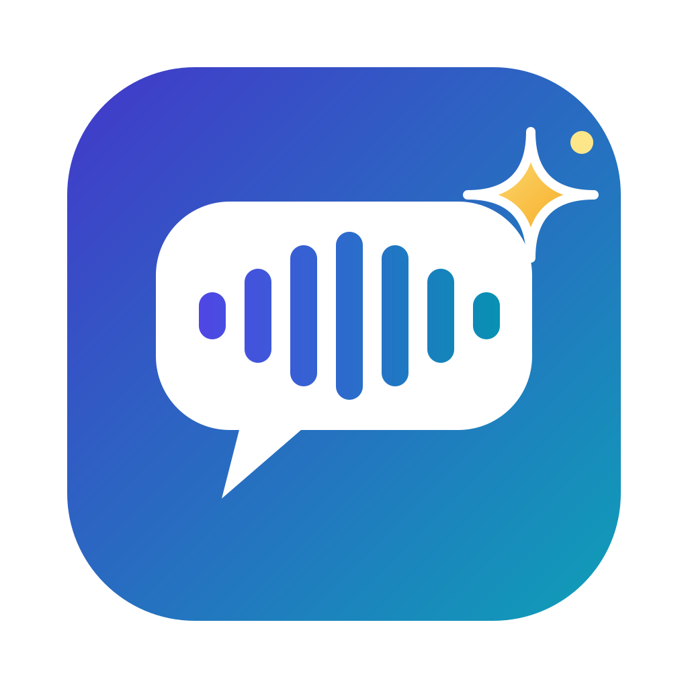

<p align="center">
  
</p>

<h1 align="center">Chumi</h1>

<p align="center">
  <b>A personal AI listening companion for lab meetings, advisor 1:1s, lectures and seminars.</b><br>
  Local speech recognition on your Mac, plus explanations from the AI subscription you already have.
</p>

---

Academic talk moves fast, and it's full of methods and terms from fields next to yours. Chumi listens alongside you and helps with three questions:

1. **Where are we?** It keeps a running overview and topic timeline. **Catch me up** covers the last 2 minutes, the last 5 minutes, or the session so far.
2. **What do I need to know to follow this?** Select any passage and ask, or turn on automatic background cards. Answers are tuned to your per-domain knowledge profile.
3. **What should I remember?** You get a structured summary for each session type. Every claim links back to the transcript with a clickable `[m:ss]`.

Audio never leaves your Mac. Only short transcript excerpts, and optionally slide captures, go to the AI provider when you ask something.

## Features

- **Live local transcription.** whisper.cpp (large-v3-turbo) runs on the Metal GPU in about 0.3 s per utterance. It handles English, Mandarin, and mixed speech with English technical terms. Partial text is revised in place, never duplicated.
- **Microphone, computer audio, or both.** Computer audio works with headphones on, which suits Zoom, Teams and recorded lectures. In "both" mode, echo cancellation and duplicate filtering keep speaker output from being transcribed twice.
- **Catch me up.** Every answer states the exact transcript interval it covers. It stays put while new speech arrives and has an explicit Refresh.
- **Ask and explain.** Questions use the selected passage, the surrounding discussion, relevant earlier passages and your profile. Answers keep **what was said**, **background added by Chumi**, and **interpretation and uncertainty** separate.
  - Depth: Quick, Standard or Deep.
  - Reasoning effort: Auto through Max.
  - Language: 中文 (keeping English terms) or English.
- **Auto-explain.** Optional background cards for unfamiliar concepts. A cooldown and an interruption cap keep them rare, and turning the switch off drops any late results.
- **Summaries by session type.** Lab meeting, advisor 1:1, lecture, or WIP talk. Tentative results stay tentative, disagreements are kept, and owners or deadlines appear only if someone said them.
- **Window capture.** Pick the Zoom share, the lecture video or the slides. Chumi keeps one picture per slide and can send captures with your questions, so answers can explain the figure being discussed.
- **Quick start.** Press **⌃⌥⌘L** from any app when a conversation starts suddenly. Press again to pause or resume.
- **Safe with your subscription.** Chumi uses one provider, the one you select, and never switches to a paid API on its own. It shows billing mode and quota, and pauses instead of spending credits.
- **Durable.** Transcript lines are saved as they arrive. After a crash or quit, the session shows a gap marker and can be resumed. Search history in English or Chinese, and export to Markdown or plain text.

## Requirements

- An Apple Silicon Mac on macOS 14.4 or later. Developed on macOS 26.5.
- [Homebrew](https://brew.sh), Node.js 24 or later, and the Xcode Command Line Tools (`xcode-select --install`). Full Xcode isn't needed.
- For AI features, one of:
  - a ChatGPT plan, signed in with the Codex CLI;
  - a Claude plan, signed in with the Claude Code CLI;
  - an Anthropic API key (optional, paid).

## Install

```bash
git clone https://github.com/FakeEnd/chumi.git && cd chumi
```

```bash
bash scripts/setup.sh
```

The setup script:

1. Installs whisper.cpp.
2. Downloads the speech model, about 875 MB, to `~/Library/Application Support/Chumi/models/`.
3. Installs the npm packages.
4. Builds the web UI.
5. Builds `build/Chumi.app` and its helper tools: audio capture, window capture and the shortcut listener.

## Run

```bash
open build/Chumi.app
```

The app gets its own macOS permissions. To run it in a browser instead, use `npm start` and open http://127.0.0.1:4777. `CHUMI_DEV=1 npm start` adds an audio-file test source and an offline test provider.

### macOS permissions

| Feature | Permission |
|---|---|
| Microphone | Privacy & Security → Microphone |
| Computer audio | Privacy & Security → Screen & System Audio Recording → *System Audio Recording Only* |
| Window capture | Privacy & Security → Screen & System Audio Recording |

macOS asks the first time each feature is used, and Chumi shows a button that opens the right pane. The app is ad-hoc signed, so **rebuilding it makes macOS ask again**. Set `CHUMI_SIGN_IDENTITY` to an Apple Development certificate for a stable identity.

With the MacBook lid closed, macOS disables the built-in microphone. Use an external or headset mic.

## AI providers and billing

Choose a provider in **Settings → AI provider**. The top bar always shows which provider is active and whether it uses a subscription or the paid API.

| Provider | Sign-in | Billing | Notes |
|---|---|---|---|
| **ChatGPT plan via Codex** | `codex login` → *Sign in with ChatGPT* | Your plan's included usage | Uses OpenAI's documented [Codex app-server](https://learn.chatgpt.com/docs/app-server). Chumi reads your usage windows and **won't spend purchased credits** unless you allow it. |
| **Claude plan via Claude Code** | `claude auth login` | Your plan's usage limits | Personal use of the unmodified `claude -p`. API-key variables are stripped so the plan is always used. Chumi stops if Claude Code reports paid overage. |
| Anthropic API key | Stored in the macOS Keychain | Pay per request | Off until you enable it and confirm. |

Speech recognition is separate and always local. An AI outage or quota limit never stops transcription, and captured content is never lost. The research behind these choices, with links to the official terms, is in [docs/provider-research.md](docs/provider-research.md).

## Using Chumi

- **Start.** Use ⚡ **Quick start** (or ⌃⌥⌘L), or **Start session…** to pick the title, type, audio source and an optional window to capture.
- **Read.** Scrolling back keeps your place, and a "N new lines · Return to live" pill counts new text. Select text for **Explain**, **Ask about this…** or **Copy**.
- **Ask.** Type a question or tap a suggestion. Depth and effort chosen in the Ask box apply to that one question and never change your profile.
- **Review.** Click any `[m:ss]` to jump to the supporting lines. End the session for the structured summary. History offers search, reopen, export, delete and resume.

**Settings tabs:**
- **Audio:** device, echo cancellation, raw-audio saving (off by default).
- **Quick start:** shortcut, source, type.
- **Screen:** whether captures are sent to the AI.
- **Transcription:** language, vocabulary hints.
- **AI provider:** model, effort, quota.
- **Assistance:** auto-explain frequency, default depth.
- **Privacy & data.**

## Privacy

- **Stays on your Mac:** audio, the transcript, AI answers, your profile and screen captures. They live in `~/Library/Application Support/Chumi/`. Raw audio is saved only if you turn that on.
- **Sent to your selected provider, only when needed:** transcript excerpts, short AI-written notes on older parts of long sessions, your profile, your question, and optionally a few screen captures. This happens when you use an AI feature, or periodically while auto-overview or auto-explain is on.
- **Credentials:** Chumi never reads Codex or Claude sign-ins; those CLIs keep them. An optional API key goes in the Keychain.

Tell participants if you record or capture a meeting, and follow your institution's rules.

## Architecture

```
Chumi.app (Swift: window + privacy identity)
├── chumi-audio   Swift · AVAudioEngine mic (+ echo cancellation) · Core Audio process tap
├── chumi-screen  Swift · ScreenCaptureKit window capture
├── chumi-hotkey  Swift · Carbon global shortcut
└── Node.js server (TypeScript, no framework, node:sqlite)
    ├── VAD segmenter → transcriber → whisper-server (local, separate process)
    ├── SQLite: sessions · raw transcript · timeline/gaps · AI outputs (kept separate) · frames
    ├── assistant: catch-up · Q&A · explain · overview · auto-explain · summary
    │     long sessions → recent window + rolling AI digests + keyword retrieval
    └── provider adapters: Codex app-server │ claude -p │ Anthropic SDK (paid, off)
React UI (Vite) ⇄ HTTP + Server-Sent Events on 127.0.0.1
```

More details are in [native/README.md](native/README.md), covering the audio helper protocol, permissions and build.

## Development

```bash
npm run check
```

This runs the type checks for server and web, plus the unit tests.

```bash
node scripts/acceptance.ts
```

The end-to-end run streams the 20-minute sample through real Whisper, using an offline test provider.

```bash
node scripts/acceptance.ts --provider claude-cli
```

The same run against a real model. It also checks summary quality, and draws on your plan's usage limits.

```bash
node scripts/check-audio.ts system 6 --play
```

This confirms real computer-audio capture. Use `mic 6` instead to test the microphone.

```bash
npm run build:tools
```

This rebuilds only the window-capture and shortcut tools, which leaves Chumi.app and its permissions untouched.

| Path | Contents |
|---|---|
| `server/` | Node server: audio pipeline, ASR, assistant, providers, storage |
| `web/` | React UI |
| `native/` | Swift app shell and helper tools, plus `build.sh` |
| `scripts/` | Setup, acceptance test, audio check, sample generator, config import |
| `samples/lab-meeting/` | Script and manifest for the synthetic 20-minute bilingual lab meeting. Generate the audio with `npm run sample`. |
| `docs/` | Provider research and the verification log |

Example settings, without secrets, are in [config/example.config.json](config/example.config.json). Apply them with `node scripts/import-config.ts config/example.config.json`.

## Status and limitations

What has been verified, and what hasn't, is listed in [docs/verification.md](docs/verification.md).

- Speakers are only distinguished as mic vs computer audio. There is no diarization.
- Rare terms depend on Whisper. Add names and jargon under Settings → Transcription → Vocabulary hints.
- Protected (DRM) video captures as black. Small text in large windows can be hard to read.
- Claude Code exposes plan usage only after each request, so remaining allowance can't be shown in advance.
- The app is ad-hoc signed, so rebuilds re-prompt for permissions.

**Roadmap:**
- Paper and slide-deck files as context.
- Speaker diarization.
- Cross-session glossary and memory.
- Spoken explanations.
- A per-app "Sign in with ChatGPT" adapter.
- A menu-bar mini mode.
- A per-session AI usage meter.
