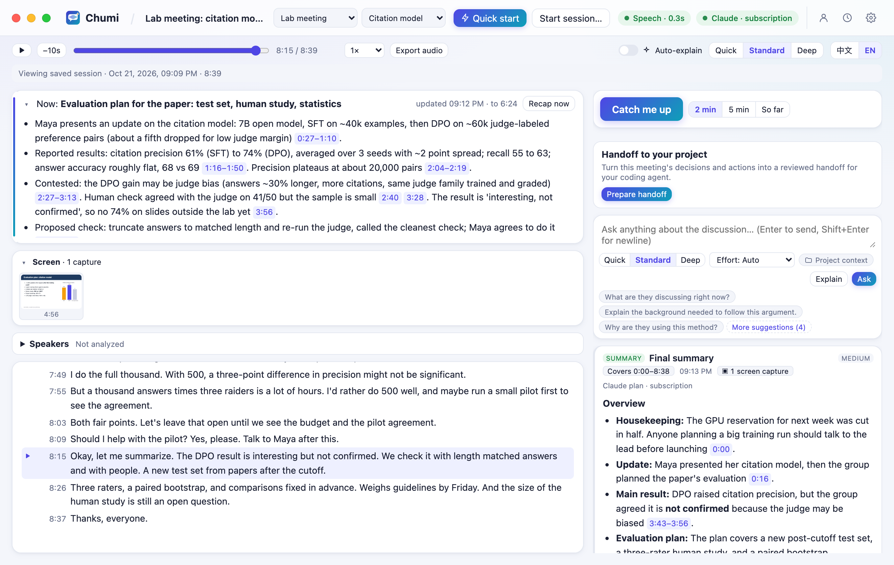
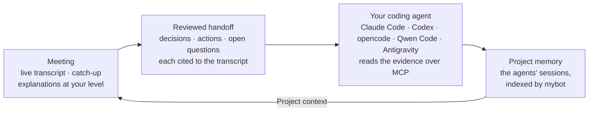

<p align="center">
  <picture>
    <source media="(prefers-color-scheme: dark)" srcset="docs/assets/banner-dark.png">
    <source media="(prefers-color-scheme: light)" srcset="docs/assets/banner-light.png">
    
  </picture>
</p>

<p align="center">
  
  
  
  
  
  <a href="LICENSE"></a>
</p>

<p align="center"><b>English</b> · <a href="README.zh-CN.md">简体中文</a></p>

<p align="center">
  <!-- Uploaded as a comment on PR #5, so GitHub streams it inline from this user-attachments URL. A video file in the
       repository only downloads. Renderers that strip <video> show the poster link inside instead. -->
  <video src="https://github.com/user-attachments/assets/6c8d26d6-d376-49f3-acc6-194e2f6edf9d" controls width="760" poster="https://raw.githubusercontent.com/FakeEnd/chumi/main/docs/assets/chumi-promo-poster.jpg">
    <a href="https://github.com/user-attachments/assets/6c8d26d6-d376-49f3-acc6-194e2f6edf9d"></a>
  </video>
</p>
<p align="center"><sub>▶ The 59-second tour, with music · player not loading? <a href="https://github.com/user-attachments/assets/6c8d26d6-d376-49f3-acc6-194e2f6edf9d">Open the video</a> · <a href="https://github.com/user-attachments/assets/65b6bba9-4126-404c-a0d7-d1037f99f8bc">中文版</a> · faster cuts to download: <a href="docs/assets/chumi-promo-1.5x.mp4">40 s</a>, <a href="docs/assets/chumi-promo-2x.mp4">30 s</a></sub></p>

---

**Chumi listens to academic meetings with you, explains what you missed, and hands what was decided to your coding agent.**

It transcribes lab meetings, advisor 1:1s, lectures and seminars on your Mac, in English, Mandarin, or both at once.

- **During the meeting:** catch up in one click, get terms explained at your level, and ask about the slide on screen. Every answer cites the moment it came from.
- **After the meeting:** read a structured summary, play the recording back from any line, and review a handoff of decisions and actions.
- **In your project:** Claude Code, Codex, opencode, Qwen Code or Antigravity continues the work, reading the original evidence through Chumi's MCP server.
- **At the next meeting:** answers can draw on what those agents already did.

It runs on the ChatGPT or Claude plan you already have, or on a local model. By default, audio never leaves your Mac.

**Contents:** [See it in action](#see-it-in-action) · [Install](#install) · [Choose an AI](#choose-an-ai) · [Privacy](#privacy) · [The agent loop](#the-agent-loop) · [All features](#all-features) · [Development](#development)

## See it in action

The screenshots come from a real run on a synthetic NLP lab meeting: Maya presents a 7B model trained with DPO to cite its sources, and the lab argues about whether its gain is real or a quirk of the LLM judge. See [About the screenshots](#about-the-screenshots).

### Lost the thread? Catch me up.

One click tells you what is being discussed now, what you missed and which question is on the table. The card states exactly which stretch of the transcript it covers, and every point links to the lines it came from.

<p align="center">
  
</p>

### Explanations pitched to you

Select a term such as *KV cache* and get the intuition, how it was used in this discussion and why it matters. Chumi keeps a per-domain profile, so a linguist new to GPUs gets a different explanation than a systems engineer would. Answers come in English or 中文.

<p align="center">
  
</p>

### Ask about the slide on screen

Capture the Zoom share, a lecture video or the slide deck. Chumi keeps one picture per slide and sends it with your question, and the answer weighs it against what was actually said.

<p align="center">
  
</p>

### A summary you can trust

When the meeting ends, the summary is shaped for its type (lab meeting, advisor 1:1, lecture, WIP talk). Preliminary results stay preliminary, disagreements are kept, and owners or deadlines appear only if someone actually said them.

<p align="center">
  
</p>

### Listen again

Each session records its audio on your Mac unless you untick **Record audio** when you start. In the saved session, the ▶ beside a line plays from there, the line being heard stays highlighted, and **Export audio** saves the whole meeting as one file.

<p align="center">
  
</p>

### Hand it to your coding agent

Chumi drafts the decisions, actions and open questions, each cited and labelled *agreed in the meeting*, *suggested, not agreed* or *proposed by Chumi*. You confirm, edit or reject every item. **Continue in Claude Code** (or another agent) opens it in the project folder with only the confirmed work.

<p align="center">
  
</p>

### The next meeting remembers

Turn on **Project context** in the Ask box, and questions also search the project's earlier Claude Code and Codex sessions through [mybot](https://github.com/jzhoulab/mybot). Answers cite them as `[P1]`, `[P2]`, next to what was said in the room.

<p align="center">
  
</p>

#### About the screenshots

They come from a real run: real local transcription, real Claude answers, and a real Claude Code session that continued the handoff. The meeting is a written script with fictional people, voiced by macOS text-to-speech ([`samples/llm-meeting-en`](samples/llm-meeting-en/README.md); the Chinese screenshots use the bilingual [`samples/llm-meeting`](samples/llm-meeting/README.md)). The profile is fictional too. Nothing comes from real meetings. [Development](#development) shows how to regenerate them.

## Install

**You need** a Mac with Apple Silicon on macOS 14.4 or later, and a ChatGPT or Claude subscription. Without one, a Mac with 16 GB of memory or more can run a free local model.

Open Terminal and paste:

```bash
curl -fsSL https://raw.githubusercontent.com/FakeEnd/chumi/main/scripts/install.sh | bash
```

This downloads Chumi into `~/Chumi`. The guided setup takes 5 to 15 minutes. It installs what is missing (asking first), sets up local speech recognition with a model that suits your Mac, builds Chumi.app, and helps you sign in to an AI. Your sign-in stays with the official tool; Chumi never sees it.

On first launch, the **Get Chumi ready** checklist on Home covers the rest: AI sign-in, your background and microphone access. Then click **⚡ Quick start**, or press **⌃⌥⌘L** from any app. Press it again to pause.

<p align="center">
  
</p>

- **By hand:** `git clone https://github.com/FakeEnd/chumi.git && cd chumi && bash scripts/setup.sh`. [The install guide](docs/install.md) covers the options (including `--mirror` for mainland China), permissions, troubleshooting and uninstalling.
- **Check an install:** `npm run doctor` prints the fix for anything missing.
- **In a browser:** `npm start`, then open http://127.0.0.1:4777.
- **Windows (desktop preview):** an installer with microphone and computer-audio capture, local speech recognition and Codex. It has passed real end-to-end checks on Windows 11. See [docs/windows.md](docs/windows.md).

## Choose an AI

Pick one in **Settings → AI provider**. Chumi uses exactly one at a time and never switches to a paid API on its own.

| AI | Sign-in | What you pay |
|---|---|---|
| **ChatGPT plan**, through OpenAI's [Codex app-server](https://learn.chatgpt.com/docs/app-server) | `codex login` | Included plan usage. Purchased credits only if you allow them. |
| **Claude plan**, through the unmodified `claude -p` | `claude auth login` | Plan usage limits. Chumi stops at paid overage. |
| **Local model** (Ollama, LM Studio) | none | Free, on your Mac. Chumi suggests models that fit its memory. |
| **Compatible API** (Qwen, Doubao, MiniMax, GLM, custom) | key in macOS Keychain | Your provider's billing; off until you enable it. |
| **Anthropic API key** | key in macOS Keychain | Pay per request; off until you enable it. |

Local models and compatible APIs are set up in [docs/other-models.md](docs/other-models.md). The reasoning behind these choices, with links to the official terms, is in [docs/provider-research.md](docs/provider-research.md).

**Speech recognition** is separate from the AI. It runs locally with whisper.cpp by default, and Settings → Transcription recommends one of seven models for your Mac. ElevenLabs Scribe and Qwen3-ASR (Alibaba Cloud or self-hosted) are opt-in alternatives that send meeting audio off the Mac; if one fails, the local model takes over. See [docs/transcription.md](docs/transcription.md).

<p align="center">
  
</p>

## Privacy

- **Audio stays on your Mac** with the default local speech recognition. Recordings are stored only on this computer, and deleting a session deletes them.
- **Everything is local:** sessions, transcripts, answers and your profile live in a SQLite database on your Mac. The server listens only on 127.0.0.1.
- **What goes to the AI** is the text it needs (and slide images, if you turn that on). Settings → Privacy & data explains exactly what is sent and when.
- **Agents only read:** the MCP server is read-only, only confirmed handoff items are requested work, and the agent proposes a plan before changing anything.

## The agent loop



To set it up:

1. **Assign the meeting to a project,** the folder you work in. Pick it when you start, or later in the top bar. Nothing is assigned automatically.
2. **Connect your coding agents** once in **Settings → Coding agents**. Chumi registers its read-only MCP server, and **Test a real agent read** confirms the agent can reach it.
3. **Optional: run [mybot](https://github.com/jzhoulab/mybot)** locally for Project context. Its address is in **Settings → Integrations** (default `http://127.0.0.1:8788`). Nothing is searched until you turn Project context on for a meeting.

If the meeting changes after you confirm (a regenerated summary, a resumed recording), Chumi and the agent both see that the handoff may need another look. Details: [docs/agents.md](docs/agents.md) and [docs/mybot.md](docs/mybot.md).

## All features

**Listening**
- Microphone for in-person meetings, computer audio for Zoom, Teams or recorded lectures (headphones are fine), or both for hybrid meetings, with echo cancellation and duplicate filtering.
- English, Mandarin and code-switching. Vocabulary hints improve the spelling of jargon and names.
- Pause, resume, a global quick-start shortcut, level meters and clear permission guidance.
- Optional speaker labels after the meeting (`npm run setup:speakers`): voices are grouped locally as A/B/C, and you name and correct them. See [docs/speaker-diarization.md](docs/speaker-diarization.md).

**Understanding**
- Catch me up over the last 2 minutes, the last 5 minutes or the whole session.
- Questions about a selected passage, the surrounding discussion and relevant earlier passages.
- Explanation depth (Quick, Standard, Deep) and, on supported providers, reasoning effort (Low to Max).
- Optional auto-explain cards for unfamiliar terms, and a running overview with a topic timeline.
- Answers form a timeline marked with the meeting time each was asked at. Only the latest stays open; the rest fold to one line and open with a click. Each question is tagged as about the meeting or a tangent.
- Answers keep *what the speakers said*, *background added by Chumi* and *interpretation and uncertainty* apart. If a speaker points at a slide Chumi can't see, it says so.

**Remembering**
- Session types (rename or add your own in Settings → Session types), each with its own summary style.
- History with full-text search in English and 中文, reopen, Markdown or plain-text export, and delete.
- Audio recording per session: every source mixed into one track in transcript time, with long pauses shortened to a one-second break. Export gives one `.m4a` on macOS (about 14 MB per hour) or a `.wav` on Windows. The original takes use about 115 MB per hour per source.
- Transcript lines are saved as they arrive. After a crash, the session reopens with a gap marker, its recorded audio is kept, and it can be resumed.
- [mybot](https://github.com/jzhoulab/mybot) in both directions: Project context reads your agents' sessions, and finished meetings can be exported into mybot's memory (owner-only by default). See [docs/mybot.md](docs/mybot.md).

**Cost control**
- Billing is shown, with quota when the provider reports it. Subscription adapters pause when included usage runs out.
- Background work (overview, auto-explain) uses low effort where supported, and long sessions use rolling notes instead of resending the whole transcript.

<details>
<summary><b>How it works</b></summary>

```
Chumi.app (Swift window + macOS privacy identity)
├── chumi-audio   AVAudioEngine mic (+ echo cancellation) · Core Audio process tap
├── chumi-screen  ScreenCaptureKit window capture
├── chumi-hotkey  global quick-start shortcut
└── Node.js server (TypeScript, node:sqlite)
    ├── voice-activity segmenter → transcriber → whisper-server (local) or an opt-in speech service
    ├── SQLite: sessions · raw transcript · gaps · AI outputs (kept separate) · screen captures
    ├── recordings: timed takes per source, mixed on the fly for playback and export
    ├── assistant: catch-up · Q&A · explain · overview · auto-explain · summary · handoff
    ├── MCP server (read-only) for coding agents
    └── providers: Codex app-server │ claude -p │ Anthropic API │ compatible local server / API
React UI ⇄ HTTP + Server-Sent Events on 127.0.0.1
```

</details>

## Development

```bash
npm run check                                  # type checks and unit tests
node scripts/acceptance.ts                     # end to end: a 20-minute sample through real Whisper, offline AI stand-in
node scripts/check-audio.ts system 6 --play    # real computer-audio capture (use "mic 6" for the microphone)
npm run build:tools                            # rebuild the window-capture and shortcut helpers
```

<details>
<summary><b>Regenerating the screenshots and video</b></summary>

1. Render the sample meetings with macOS `say` (about a minute each): `node scripts/make-sample.mjs --script samples/llm-meeting-en/script.json`, and the same for `samples/llm-meeting`.
2. Agent loop, once: `node scripts/demo-shoot.ts --prepare-agent --project-folder DIR` drafts and confirms a handoff for a project folder and keeps its data folder. Run Claude Code (or Codex) in `DIR` with that prompt and Chumi's MCP server pointed at the kept data folder, and let mybot index the session.
3. Screenshots: `node scripts/demo-shoot.ts --project-folder DIR` (add `--lang zh` for the Chinese set in `docs/assets/screens/zh/`). It uses about 15 requests on your Claude plan.
4. Video: `node scripts/make-video.ts` renders `docs/video/promo.html`; add `--lang zh`, or `--speed 1.5` / `--speed 2` for the faster cuts. `bash scripts/make-banner.sh` re-renders the banner.

</details>

| Path | Contents |
|---|---|
| `server/` | Audio pipeline, speech recognition, recordings, assistant, AI providers, MCP server, storage |
| `web/` | React interface |
| `native/` | Swift app shell and helpers ([native/README.md](native/README.md)), and the Windows desktop app |
| `scripts/` | Setup, acceptance test, audio check, screenshots, video, sample generator |
| `samples/` | Synthetic meetings: `llm-meeting` (screenshots, video) and `lab-meeting` (acceptance tests) |
| `integrations/mybot/` | mybot source adapter, patch, installer and test |
| `docs/` | Guides, [provider research](docs/provider-research.md) and the [verification log](docs/verification.md) |

## Status

Chumi is a working personal tool. What has been verified, and how, is in [docs/verification.md](docs/verification.md).

**Known limits:** speaker labels run after the meeting and don't identify real people; protected (DRM) video captures as black; Claude reports plan usage only after each request; the app is ad-hoc signed, so rebuilds ask for permissions again.

**Next:** paper and slide-deck files as context, live speaker labels, a cross-session glossary, spoken explanations, a menu-bar mini mode, and a per-session usage meter.

**Related:** [mybot](https://github.com/jzhoulab/mybot), one searchable memory for all your Claude Code and Codex conversations; [nebula-notebook](https://github.com/jzhoulab/nebula-notebook), an agent-native notebook.

## License

MIT. See [LICENSE](LICENSE). Speech models are downloaded from the whisper.cpp project (MIT) and are not part of this repository.
