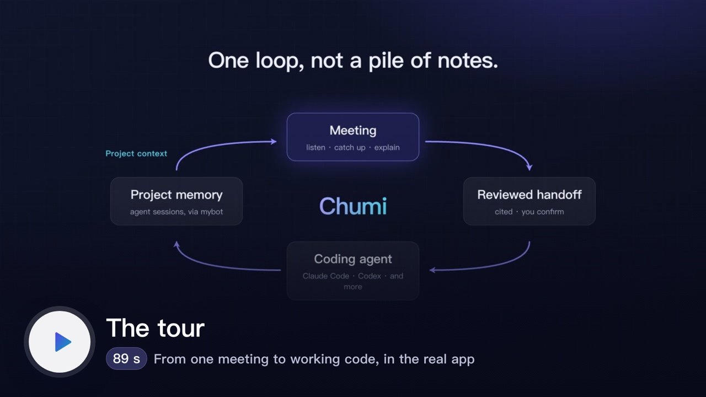
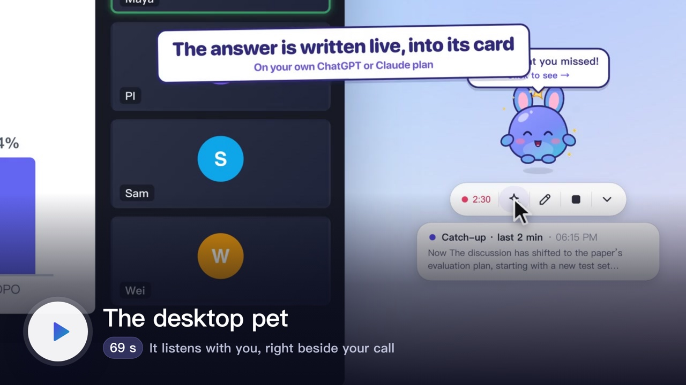
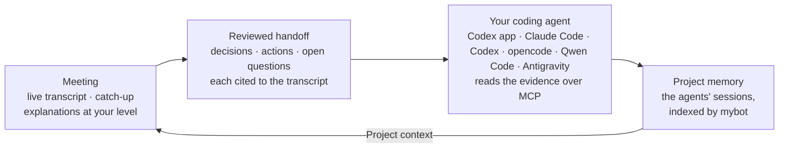

<p align="center">
  <picture>
    <source media="(prefers-color-scheme: dark)" srcset="docs/assets/banner-dark.png">
    <source media="(prefers-color-scheme: light)" srcset="docs/assets/banner-light.png">
    
  </picture>
</p>

<p align="center">
  
  
  
  
  
  <a href="LICENSE"></a>
</p>

<p align="center"><b>English</b> · <a href="README.zh-CN.md">简体中文</a></p>

<!-- Each card links to its video as uploaded to GitHub (dragged into a comment), and GitHub shows that link as its own player; it only offers MP4s stored in the repo as downloads. scripts/make-banner.sh makes each card its video's first frame, so the players rest on the cards. After re-rendering, run it, upload the four MP4s again and replace the links here and in README.zh-CN.md. -->
<table align="center">
  <tr>
    <td width="420"><a href="https://github.com/user-attachments/assets/e1b6437f-6c71-4a74-af53-8a2820997daf"></a></td>
    <td width="420"><a href="https://github.com/user-attachments/assets/82eb1067-9354-4e0e-9508-450eec2c0bfa"></a></td>
  </tr>
  <tr>
    <td align="center"><sub>With music · <a href="https://github.com/user-attachments/assets/68e90c64-7d3b-45d2-a398-a71004f0182b">中文</a> · faster cuts to download: <a href="docs/assets/chumi-promo-1.5x.mp4?raw=1">59 s</a>, <a href="docs/assets/chumi-promo-2x.mp4?raw=1">45 s</a></sub></td>
    <td align="center"><sub>Chumi.app's desktop pet · <a href="docs/desktop-pet.md">how it works</a> · <a href="https://github.com/user-attachments/assets/9ca3c9d6-2b5c-4227-bb9b-6ee339c41413">中文</a></sub></td>
  </tr>
</table>

**Chumi listens to academic meetings with you, explains what you missed, and hands what was decided to your coding agent.**

It transcribes lab meetings, advisor 1:1s, lectures and seminars on your Mac, in English, Mandarin, or both at once.

- **During the meeting:** catch up in one click, get terms explained at your level, and ask about the slide on screen. Every answer cites the moment it came from. A desktop pet can sit beside your call and do the same from its toolbar.
- **After the meeting:** read a structured summary, play the recording back from any line, and review a handoff of decisions and actions.
- **In your project:** Codex app, Claude Code, Codex, opencode, Qwen Code or Antigravity continues the work, reading the original evidence through Chumi's MCP server.
- **At the next meeting:** answers can draw on what those agents already did.

It runs on the ChatGPT or Claude plan you already have, or on a local model. By default, audio never leaves your Mac.

**Contents:** [See it in action](#see-it-in-action) · [Install](#install) · [Choose an AI](#choose-an-ai) · [Privacy](#privacy) · [The agent loop](#the-agent-loop) · [All features](#all-features) · [Development](#development)

## See it in action

Real screens from a synthetic NLP lab meeting: Maya presents a 7B model trained with DPO to cite its sources, and the lab argues about whether its gain is real or a quirk of the LLM judge. **Scroll sideways for all nine →**

<!-- One row that scrolls sideways. The figure spaces (&#8199;) at the end of each cell keep it 520 px wide: GitHub
     shrinks images in table cells to fit, so without them the nine screenshots squeeze into one screen width. -->
<table>
  <tr>
    <td width="520" valign="top">
      <a href="docs/assets/screens/live.png"></a><br>
      <b>Lost the thread? Catch me up.</b><br>
      <sub>What you missed and what is being argued now, over the last 2 or 5 minutes or the whole meeting. Every point links to its lines.</sub><br><sub>&#8199;&#8199;&#8199;&#8199;&#8199;&#8199;&#8199;&#8199;&#8199;&#8199;&#8199;&#8199;&#8199;&#8199;&#8199;&#8199;&#8199;&#8199;&#8199;&#8199;&#8199;&#8199;&#8199;&#8199;&#8199;&#8199;&#8199;&#8199;&#8199;&#8199;&#8199;&#8199;&#8199;&#8199;&#8199;&#8199;&#8199;&#8199;&#8199;&#8199;&#8199;&#8199;&#8199;&#8199;&#8199;&#8199;&#8199;&#8199;&#8199;&#8199;&#8199;&#8199;&#8199;&#8199;&#8199;&#8199;&#8199;&#8199;&#8199;&#8199;&#8199;&#8199;&#8199;&#8199;&#8199;&#8199;&#8199;&#8199;&#8199;&#8199;</sub>
    </td>
    <td width="520" valign="top">
      <a href="docs/assets/screens/explain.png"></a><br>
      <b>Explained at your level</b><br>
      <sub>Select a term like <i>KV cache</i>: the intuition, how it was used here and why it matters, pitched to your background. In English or 中文.</sub><br><sub>&#8199;&#8199;&#8199;&#8199;&#8199;&#8199;&#8199;&#8199;&#8199;&#8199;&#8199;&#8199;&#8199;&#8199;&#8199;&#8199;&#8199;&#8199;&#8199;&#8199;&#8199;&#8199;&#8199;&#8199;&#8199;&#8199;&#8199;&#8199;&#8199;&#8199;&#8199;&#8199;&#8199;&#8199;&#8199;&#8199;&#8199;&#8199;&#8199;&#8199;&#8199;&#8199;&#8199;&#8199;&#8199;&#8199;&#8199;&#8199;&#8199;&#8199;&#8199;&#8199;&#8199;&#8199;&#8199;&#8199;&#8199;&#8199;&#8199;&#8199;&#8199;&#8199;&#8199;&#8199;&#8199;&#8199;&#8199;&#8199;&#8199;&#8199;</sub>
    </td>
    <td width="520" valign="top">
      <a href="docs/assets/screens/window-capture.png"></a><br>
      <b>Ask about the slide on screen</b><br>
      <sub>Capture the Zoom share or a lecture video. Chumi keeps one picture per slide and weighs it against what was actually said.</sub><br><sub>&#8199;&#8199;&#8199;&#8199;&#8199;&#8199;&#8199;&#8199;&#8199;&#8199;&#8199;&#8199;&#8199;&#8199;&#8199;&#8199;&#8199;&#8199;&#8199;&#8199;&#8199;&#8199;&#8199;&#8199;&#8199;&#8199;&#8199;&#8199;&#8199;&#8199;&#8199;&#8199;&#8199;&#8199;&#8199;&#8199;&#8199;&#8199;&#8199;&#8199;&#8199;&#8199;&#8199;&#8199;&#8199;&#8199;&#8199;&#8199;&#8199;&#8199;&#8199;&#8199;&#8199;&#8199;&#8199;&#8199;&#8199;&#8199;&#8199;&#8199;&#8199;&#8199;&#8199;&#8199;&#8199;&#8199;&#8199;&#8199;&#8199;&#8199;</sub>
    </td>
    <td width="520" valign="top">
      <a href="docs/assets/screens/summary.png"></a><br>
      <b>A summary you can trust</b><br>
      <sub>Shaped for the meeting type. Preliminary results stay preliminary, disagreements are kept, and owners appear only if someone named them.</sub><br><sub>&#8199;&#8199;&#8199;&#8199;&#8199;&#8199;&#8199;&#8199;&#8199;&#8199;&#8199;&#8199;&#8199;&#8199;&#8199;&#8199;&#8199;&#8199;&#8199;&#8199;&#8199;&#8199;&#8199;&#8199;&#8199;&#8199;&#8199;&#8199;&#8199;&#8199;&#8199;&#8199;&#8199;&#8199;&#8199;&#8199;&#8199;&#8199;&#8199;&#8199;&#8199;&#8199;&#8199;&#8199;&#8199;&#8199;&#8199;&#8199;&#8199;&#8199;&#8199;&#8199;&#8199;&#8199;&#8199;&#8199;&#8199;&#8199;&#8199;&#8199;&#8199;&#8199;&#8199;&#8199;&#8199;&#8199;&#8199;&#8199;&#8199;&#8199;</sub>
    </td>
    <td width="520" valign="top">
      <a href="docs/assets/screens/playback.png"></a><br>
      <b>Listen again</b><br>
      <sub>The ▶ beside a line plays from there, and the line being heard stays highlighted. <b>Export audio</b> saves the meeting as one file.</sub><br><sub>&#8199;&#8199;&#8199;&#8199;&#8199;&#8199;&#8199;&#8199;&#8199;&#8199;&#8199;&#8199;&#8199;&#8199;&#8199;&#8199;&#8199;&#8199;&#8199;&#8199;&#8199;&#8199;&#8199;&#8199;&#8199;&#8199;&#8199;&#8199;&#8199;&#8199;&#8199;&#8199;&#8199;&#8199;&#8199;&#8199;&#8199;&#8199;&#8199;&#8199;&#8199;&#8199;&#8199;&#8199;&#8199;&#8199;&#8199;&#8199;&#8199;&#8199;&#8199;&#8199;&#8199;&#8199;&#8199;&#8199;&#8199;&#8199;&#8199;&#8199;&#8199;&#8199;&#8199;&#8199;&#8199;&#8199;&#8199;&#8199;&#8199;&#8199;</sub>
    </td>
    <td width="520" valign="top">
      <a href="docs/assets/screens/handoff.png"></a><br>
      <b>A handoff you review</b><br>
      <sub>Decisions and actions, each cited and labelled by origin. Confirm, edit or reject each one, then <b>Continue in</b> Codex app or Claude Code.</sub><br><sub>&#8199;&#8199;&#8199;&#8199;&#8199;&#8199;&#8199;&#8199;&#8199;&#8199;&#8199;&#8199;&#8199;&#8199;&#8199;&#8199;&#8199;&#8199;&#8199;&#8199;&#8199;&#8199;&#8199;&#8199;&#8199;&#8199;&#8199;&#8199;&#8199;&#8199;&#8199;&#8199;&#8199;&#8199;&#8199;&#8199;&#8199;&#8199;&#8199;&#8199;&#8199;&#8199;&#8199;&#8199;&#8199;&#8199;&#8199;&#8199;&#8199;&#8199;&#8199;&#8199;&#8199;&#8199;&#8199;&#8199;&#8199;&#8199;&#8199;&#8199;&#8199;&#8199;&#8199;&#8199;&#8199;&#8199;&#8199;&#8199;&#8199;&#8199;</sub>
    </td>
    <td width="520" valign="top">
      <a href="docs/assets/screens/project-context.png"></a><br>
      <b>The next meeting remembers</b><br>
      <sub>Turn on <b>Project context</b> and answers also cite your agents' earlier sessions, found through <a href="https://github.com/jzhoulab/mybot">mybot</a>, as [P1], [P2].</sub><br><sub>&#8199;&#8199;&#8199;&#8199;&#8199;&#8199;&#8199;&#8199;&#8199;&#8199;&#8199;&#8199;&#8199;&#8199;&#8199;&#8199;&#8199;&#8199;&#8199;&#8199;&#8199;&#8199;&#8199;&#8199;&#8199;&#8199;&#8199;&#8199;&#8199;&#8199;&#8199;&#8199;&#8199;&#8199;&#8199;&#8199;&#8199;&#8199;&#8199;&#8199;&#8199;&#8199;&#8199;&#8199;&#8199;&#8199;&#8199;&#8199;&#8199;&#8199;&#8199;&#8199;&#8199;&#8199;&#8199;&#8199;&#8199;&#8199;&#8199;&#8199;&#8199;&#8199;&#8199;&#8199;&#8199;&#8199;&#8199;&#8199;&#8199;&#8199;</sub>
    </td>
    <td width="520" valign="top">
      <a href="docs/assets/screens/home.png"></a><br>
      <b>Get Chumi ready</b><br>
      <sub>Home walks you through AI sign-in, your background and the microphone. Then <b>⚡ Quick start</b>, or <b>⌃⌥⌘L</b> from any app.</sub><br><sub>&#8199;&#8199;&#8199;&#8199;&#8199;&#8199;&#8199;&#8199;&#8199;&#8199;&#8199;&#8199;&#8199;&#8199;&#8199;&#8199;&#8199;&#8199;&#8199;&#8199;&#8199;&#8199;&#8199;&#8199;&#8199;&#8199;&#8199;&#8199;&#8199;&#8199;&#8199;&#8199;&#8199;&#8199;&#8199;&#8199;&#8199;&#8199;&#8199;&#8199;&#8199;&#8199;&#8199;&#8199;&#8199;&#8199;&#8199;&#8199;&#8199;&#8199;&#8199;&#8199;&#8199;&#8199;&#8199;&#8199;&#8199;&#8199;&#8199;&#8199;&#8199;&#8199;&#8199;&#8199;&#8199;&#8199;&#8199;&#8199;&#8199;&#8199;</sub>
    </td>
    <td width="520" valign="top">
      <a href="docs/assets/screens/models.png"></a><br>
      <b>Speech stays on your Mac</b><br>
      <sub>Local whisper.cpp, with a model picked for your Mac. Cloud speech recognition only if you choose it.</sub><br><sub>&#8199;&#8199;&#8199;&#8199;&#8199;&#8199;&#8199;&#8199;&#8199;&#8199;&#8199;&#8199;&#8199;&#8199;&#8199;&#8199;&#8199;&#8199;&#8199;&#8199;&#8199;&#8199;&#8199;&#8199;&#8199;&#8199;&#8199;&#8199;&#8199;&#8199;&#8199;&#8199;&#8199;&#8199;&#8199;&#8199;&#8199;&#8199;&#8199;&#8199;&#8199;&#8199;&#8199;&#8199;&#8199;&#8199;&#8199;&#8199;&#8199;&#8199;&#8199;&#8199;&#8199;&#8199;&#8199;&#8199;&#8199;&#8199;&#8199;&#8199;&#8199;&#8199;&#8199;&#8199;&#8199;&#8199;&#8199;&#8199;&#8199;&#8199;</sub>
    </td>
  </tr>
</table>

<sub>About the screenshots: real local transcription, real AI answers, and real agent sessions that continued the handoff. The meeting is a written script with fictional people, voiced by macOS text-to-speech (<a href="samples/llm-meeting-en/README.md"><code>samples/llm-meeting-en</code></a>; the Chinese set uses the bilingual <a href="samples/llm-meeting/README.md"><code>samples/llm-meeting</code></a>), and the profile is fictional too. Nothing comes from real meetings.</sub>

## Install

**You need** a Mac with Apple Silicon on macOS 14.4 or later, and a ChatGPT or Claude subscription. Without one, a Mac with 16 GB of memory or more can run a free local model.

Open Terminal and paste:

```bash
curl -fsSL https://raw.githubusercontent.com/FakeEnd/chumi/main/scripts/install.sh | bash
```

This downloads Chumi into `~/Chumi`. The guided setup takes 5 to 15 minutes. It installs what is missing (asking first), sets up local speech recognition with a model that suits your Mac, builds Chumi.app, and helps you sign in to an AI. Your sign-in stays with the official tool; Chumi never sees it.

On first launch, the **Get Chumi ready** checklist on Home covers the rest: AI sign-in, your background and microphone access. Then click **⚡ Quick start**, or press **⌃⌥⌘L** from any app. Press it again to pause.

- **By hand:** `git clone https://github.com/FakeEnd/chumi.git && cd chumi && bash scripts/setup.sh`. [The install guide](docs/install.md) covers the options (including `--mirror` for mainland China), permissions, troubleshooting and uninstalling.
- **Check an install:** `npm run doctor` prints the fix for anything missing.
- **In a browser:** `npm start`, then open http://127.0.0.1:4777.
- **Windows (desktop preview):** an installer with microphone and computer-audio capture, local speech recognition, Codex and the desktop pet. It includes the shared recording, handoff and project-progress workflows. See [docs/windows.md](docs/windows.md) for Windows 11 verification and build instructions.
- **iPhone (prototype):** a SwiftUI app in [`ios/`](ios/README.md) records and transcribes on the phone with Apple Speech, and pairs with Chumi on the Mac for AI help. It needs full Xcode and hasn't yet been compiled or tested on a device. See [the iPhone guide](ios/README.md).

## Choose an AI

Pick one in **Settings → AI provider**. Chumi uses exactly one at a time and never switches to a paid API on its own.

| AI | Sign-in | What you pay |
|---|---|---|
| **ChatGPT plan**, through OpenAI's [Codex app-server](https://learn.chatgpt.com/docs/app-server) | `codex login` | Included plan usage. Purchased credits only if you allow them. |
| **Claude plan**, through the unmodified `claude -p` | `claude auth login` | Plan usage limits. Chumi stops at paid overage. |
| **Local model** (Ollama, LM Studio) | none | Free, on your Mac. Chumi suggests models that fit its memory. |
| **Compatible API** (Qwen, Doubao, MiniMax, GLM, custom) | key in macOS Keychain | Your provider's billing; off until you enable it. |
| **Anthropic API key** | key in macOS Keychain | Pay per request; off until you enable it. |

Local models and compatible APIs are set up in [docs/other-models.md](docs/other-models.md). The reasoning behind these choices, with links to the official terms, is in [docs/provider-research.md](docs/provider-research.md).

**Speech recognition** is separate from the AI. It runs locally with whisper.cpp by default, and Settings → Transcription recommends one of seven models for your Mac. ElevenLabs Scribe and Qwen3-ASR (Alibaba Cloud or self-hosted) are opt-in alternatives that send meeting audio off the Mac; if one fails, the local model takes over. See [docs/transcription.md](docs/transcription.md).

## Privacy

- **Audio stays on your Mac** with the default local speech recognition. Recordings are stored only on this computer, and deleting a session deletes them.
- **Everything is local:** sessions, transcripts, answers and your profile live in a SQLite database on your Mac. The server listens only on 127.0.0.1.
- **What goes to the AI** is the text it needs (and slide images, if you turn that on). Settings → Privacy & data explains exactly what is sent and when.
- **Agents only read:** the MCP server is read-only, only confirmed handoff items are requested work, and the agent proposes a plan before changing anything.

## The agent loop



To set it up:

1. **Assign the meeting to a project,** the folder you work in. Pick it when you start, or later in the top bar. Nothing is assigned automatically.
2. **Choose where to continue.** Codex app is the default and needs no setup: Continue opens a new chat with the handoff in its composer, and nothing runs until you click Send. To let terminal agents fetch the original passages too, connect them once in **Settings → Coding agents**; **Test a real agent read** confirms the agent can reach Chumi's read-only MCP server.
3. **Optional: run [mybot](https://github.com/jzhoulab/mybot)** locally for Project context. Its address is in **Settings → Integrations** (default `http://127.0.0.1:8788`). Nothing is searched until you turn Project context on for a meeting.

If the meeting changes after you confirm (a regenerated summary, a resumed recording), Chumi and the agent both see that the handoff may need another look. Details: [docs/agents.md](docs/agents.md) and [docs/mybot.md](docs/mybot.md).

## All features

<details>
<summary><b>Show the full list</b></summary>

**Listening**
- Microphone for in-person meetings, computer audio for Zoom, Teams or recorded lectures (headphones are fine), or both for hybrid meetings, with echo cancellation and duplicate filtering.
- English, Mandarin and code-switching. Vocabulary hints improve the spelling of jargon and names.
- Pause, resume, a global quick-start shortcut, level meters and clear permission guidance.
- Compact view (`⌘⇧.`, or `Ctrl+Shift+.` on Windows) hides the header and toolbar, leaving the summary, transcript and assistant.
- Optional speaker labels after the meeting (`npm run setup:speakers`): voices are grouped locally as A/B/C, and you name and correct them. See [docs/speaker-diarization.md](docs/speaker-diarization.md).
- A desktop pet in Chumi.app: its toolbar starts, pauses and ends a meeting, catches you up and takes a question, and continues a confirmed handoff. Clicks elsewhere pass through, and it stays out of screen shares. See [docs/desktop-pet.md](docs/desktop-pet.md).

**Understanding**
- Catch me up over the last 2 minutes, the last 5 minutes or the whole session.
- Questions about a selected passage, the surrounding discussion and relevant earlier passages.
- Explanation depth (Quick, Standard, Deep) and, on supported providers, reasoning effort (Low to Max).
- Optional auto-explain cards for unfamiliar terms, and a running overview with a topic timeline.
- Answers form a timeline marked with the meeting time each was asked at. Only the latest stays open; the rest fold to one line and open with a click. Each question is tagged as about the meeting or a tangent.
- Answers keep *what the speakers said*, *background added by Chumi* and *interpretation and uncertainty* apart. If a speaker points at a slide Chumi can't see, it says so.

**Remembering**
- Session types (rename or add your own in Settings → Session types), each with its own summary style.
- History with full-text search in English and 中文, reopen, Markdown or plain-text export, and delete.
- Audio recording per session: every source mixed into one track in transcript time, with long pauses shortened to a one-second break. Export gives one `.m4a` on macOS (about 14 MB per hour) or a `.wav` on Windows. The original takes use about 115 MB per hour per source.
- Transcript lines are saved as they arrive. After a crash, the session reopens with a gap marker, its recorded audio is kept, and it can be resumed.
- [mybot](https://github.com/jzhoulab/mybot) in both directions: Project context reads your agents' sessions, and finished meetings can be exported into mybot's memory (owner-only by default). See [docs/mybot.md](docs/mybot.md).

**Cost control**
- Billing is shown, with quota when the provider reports it. Subscription adapters pause when included usage runs out.
- Background work (overview, auto-explain) uses low effort where supported, and long sessions use rolling notes instead of resending the whole transcript.

</details>

<details>
<summary><b>How it works</b></summary>

```
Chumi.app (Swift window + macOS privacy identity)
├── chumi-audio   AVAudioEngine mic (+ echo cancellation) · Core Audio process tap
├── chumi-screen  ScreenCaptureKit window capture
├── chumi-hotkey  global quick-start shortcut
└── Node.js server (TypeScript, node:sqlite)
    ├── voice-activity segmenter → transcriber → whisper-server (local) or an opt-in speech service
    ├── SQLite: sessions · raw transcript · gaps · AI outputs (kept separate) · screen captures
    ├── recordings: timed takes per source, mixed on the fly for playback and export
    ├── assistant: catch-up · Q&A · explain · overview · auto-explain · summary · handoff
    ├── MCP server (read-only) for coding agents
    └── providers: Codex app-server │ claude -p │ Anthropic API │ compatible local server / API
React UI ⇄ HTTP + Server-Sent Events on 127.0.0.1
```

</details>

## Development

```bash
npm run check                                  # type checks and unit tests
node scripts/acceptance.ts                     # end to end: a 20-minute sample through real Whisper, offline AI stand-in
node scripts/check-audio.ts system 6 --play    # real computer-audio capture (use "mic 6" for the microphone)
npm run build:tools                            # rebuild the window-capture and shortcut helpers
```

<details>
<summary><b>Regenerating the screenshots and video</b></summary>

1. Render the sample meetings with macOS `say` (about a minute each): `node scripts/make-sample.mjs --script samples/llm-meeting-en/script.json`, and the same for `samples/llm-meeting`.
2. Agent loop, once: `node scripts/demo-shoot.ts --prepare-agent --project-folder DIR` drafts and confirms a handoff for a project folder and keeps its data folder. Run Claude Code (or Codex) in `DIR` with that prompt and Chumi's MCP server pointed at the kept data folder, and let mybot index the session.
3. Screenshots: `node scripts/demo-shoot.ts --project-folder DIR` (add `--lang zh` for the Chinese set in `docs/assets/screens/zh/`). It uses about 15 requests on your Claude plan, or on your ChatGPT plan with `--provider codex`.
4. Live footage: `node scripts/record-footage.ts` (and `--lang zh`) records the real window and desktop pet while the answers stream in, into `dist/footage/`. It rebuilds the web UI first, then uses about 6 requests (Codex by default; `--provider claude-cli` for your Claude plan). `--only agent --project-folder DIR` records continuing a confirmed handoff (nothing is actually opened) and keeps its data folder for a real agent run in `DIR`.
5. Video: `node scripts/make-video.ts` renders `docs/video/promo.html`; add `--lang zh`, or `--speed 1.5` / `--speed 2` for the faster cuts. `node scripts/make-pet-video.ts` renders the desktop-pet video (`--lang en` for English). Both need the footage from step 4. Then `bash scripts/make-banner.sh` re-renders the banner and the two video cards, and makes each card its video's first frame. Upload the four tour and pet MP4s to GitHub (drag them into a comment) and put their links on the cards: GitHub shows them as players.

</details>

| Path | Contents |
|---|---|
| `server/` | Audio pipeline, speech recognition, recordings, assistant, AI providers, MCP server, storage |
| `web/` | React interface |
| `native/` | Swift app shell and helpers ([native/README.md](native/README.md)), and the Windows desktop app |
| `scripts/` | Setup, acceptance test, audio check, screenshots, video, sample generator |
| `samples/` | Synthetic meetings: `llm-meeting` (screenshots, video) and `lab-meeting` (acceptance tests) |
| `integrations/mybot/` | mybot source adapter, patch, installer and test |
| `docs/` | Guides, [provider research](docs/provider-research.md) and the [verification log](docs/verification.md) |

## Status

Chumi is a working personal tool. What has been verified, and how, is in [docs/verification.md](docs/verification.md).

**Known limits:** speaker labels run after the meeting and don't identify real people; protected (DRM) video captures as black; Claude reports plan usage only after each request; the app is ad-hoc signed, so rebuilds ask for permissions again.

**Next:** paper and slide-deck files as context, live speaker labels, a cross-session glossary, spoken explanations, a menu-bar mini mode, and a per-session usage meter.

**Related:** [mybot](https://github.com/jzhoulab/mybot), one searchable memory for all your Claude Code and Codex conversations; [nebula-notebook](https://github.com/jzhoulab/nebula-notebook), an agent-native notebook.

## License

MIT. See [LICENSE](LICENSE). Speech models are downloaded from the whisper.cpp project (MIT) and are not part of this repository.
