<p align="center">
  <picture>
    <source media="(prefers-color-scheme: dark)" srcset="docs/assets/banner-zh-dark.png">
    <source media="(prefers-color-scheme: light)" srcset="docs/assets/banner-zh-light.png">
    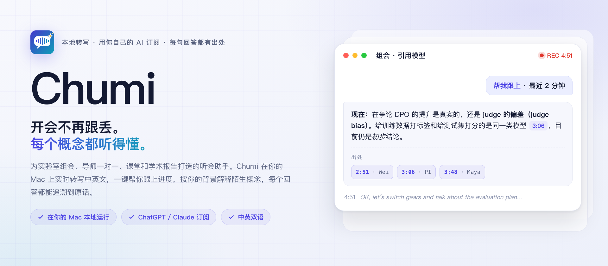
  </picture>
</p>

<p align="center">
  
  
  
  
  
  <a href="LICENSE"></a>
</p>

<p align="center"><a href="README.md">English</a> · <b>简体中文</b></p>

<!-- 每张卡片链接到上传到 GitHub 的视频（拖进评论框得到的链接），GitHub 会把这种链接显示成播放器；仓库里的 MP4，GitHub 只提供下载。scripts/make-banner.sh 会把卡片做成视频的第一帧，播放器未播放时显示的就是卡片。重新渲染后，运行它，把四个 MP4 重新上传，并替换这里和 README.md 中的链接。 -->
<table align="center">
  <tr>
    <td width="420"><a href="https://github.com/user-attachments/assets/68e90c64-7d3b-45d2-a398-a71004f0182b">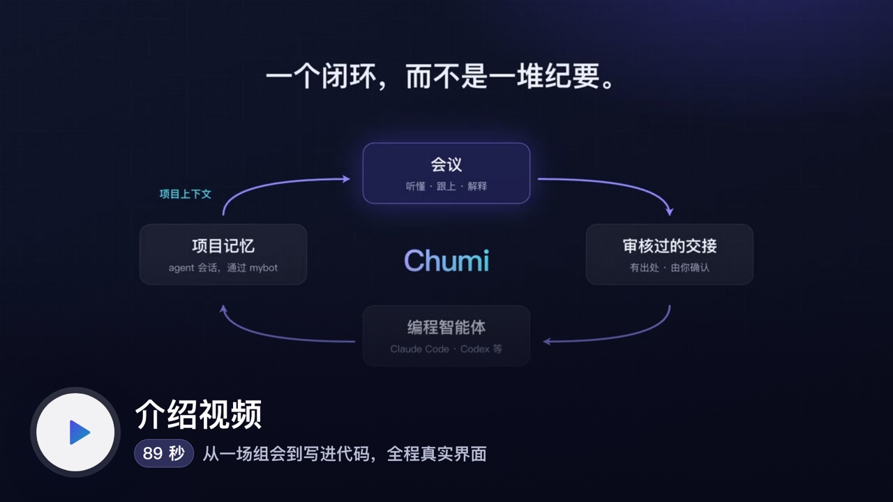</a></td>
    <td width="420"><a href="https://github.com/user-attachments/assets/9ca3c9d6-2b5c-4227-bb9b-6ee339c41413">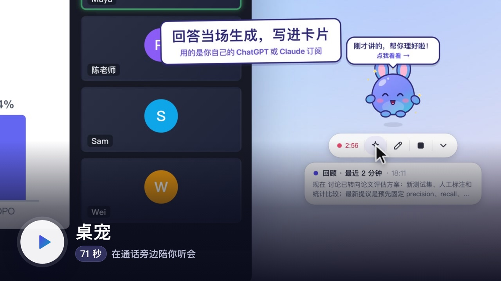</a></td>
  </tr>
  <tr>
    <td align="center"><sub>有背景音乐 · <a href="https://github.com/user-attachments/assets/e1b6437f-6c71-4a74-af53-8a2820997daf">English</a> · 快剪版下载：<a href="docs/assets/chumi-promo-zh-1.5x.mp4?raw=1">59 秒</a>、<a href="docs/assets/chumi-promo-zh-2x.mp4?raw=1">45 秒</a></sub></td>
    <td align="center"><sub>Chumi.app 的桌宠 · <a href="docs/desktop-pet.md">使用说明</a> · <a href="https://github.com/user-attachments/assets/82eb1067-9354-4e0e-9508-450eec2c0bfa">English</a></sub></td>
  </tr>
</table>

**Chumi 陪你听学术会议，帮你补上没听懂的部分，再把会上定下的事交给你的编程智能体接着做。**

它在你的 Mac 上转写实验室组会、与导师的一对一交流、课堂和学术报告，支持英语、普通话和中英混合发言。

- **会议进行中：** 一键回顾讨论，按你的个人背景解释术语，还能就屏幕上的幻灯片提问。回答会引用对应的发言时间，便于核对原话。桌宠可以待在通话窗口旁边，用它的工具栏做同样的事。
- **会议结束后：** 阅读结构化总结，从任意转写行回放录音，并审阅包含决定和行动项的交接内容。
- **在你的项目里：** Codex app、Claude Code、Codex、opencode、Qwen Code、Antigravity 或 DeepSeek Harness 继续处理后续工作，通过 Chumi 的 MCP 服务读取原始依据。
- **下次开会：** 回答可以参考这些智能体此前的工作记录。

AI 功能可使用你已有的 ChatGPT 或 Claude 订阅，也可以使用本地模型。默认情况下，音频不会离开你的 Mac。

**目录：** [实际效果](#实际效果) · [安装](#安装) · [选择 AI](#选择-ai) · [隐私](#隐私) · [Agent 闭环](#agent-闭环) · [全部功能](#全部功能) · [开发](#开发)

## 实际效果

截图来自一场虚构的 NLP 组会：Maya 介绍一个经 DPO 训练、回答时需标注出处的 7B 模型，大家讨论性能提升究竟来自模型改进，还是 LLM 评判模型的偏差。**左右滑动查看全部九张 →**

<!-- 一行横向滚动。每格末尾的数字空格（&#8199;）让格子保持 520 像素宽：GitHub 会缩小表格里的图片，没有它们，九张截图会挤在一屏里。 -->
<table>
  <tr>
    <td width="520" valign="top">
      <a href="docs/assets/screens/zh/live.png">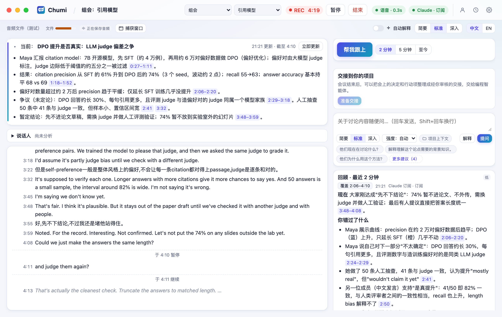</a><br>
      <b>跟丢了？帮我跟上</b><br>
      <sub>回顾最近 2 分钟、5 分钟或整场的讨论：错过了什么、正在争什么。每个要点都附有原话链接。</sub><br><sub>&#8199;&#8199;&#8199;&#8199;&#8199;&#8199;&#8199;&#8199;&#8199;&#8199;&#8199;&#8199;&#8199;&#8199;&#8199;&#8199;&#8199;&#8199;&#8199;&#8199;&#8199;&#8199;&#8199;&#8199;&#8199;&#8199;&#8199;&#8199;&#8199;&#8199;&#8199;&#8199;&#8199;&#8199;&#8199;&#8199;&#8199;&#8199;&#8199;&#8199;&#8199;&#8199;&#8199;&#8199;&#8199;&#8199;&#8199;&#8199;&#8199;&#8199;&#8199;&#8199;&#8199;&#8199;&#8199;&#8199;&#8199;&#8199;&#8199;&#8199;&#8199;&#8199;&#8199;&#8199;&#8199;&#8199;&#8199;&#8199;&#8199;&#8199;</sub>
    </td>
    <td width="520" valign="top">
      <a href="docs/assets/screens/zh/explain.png">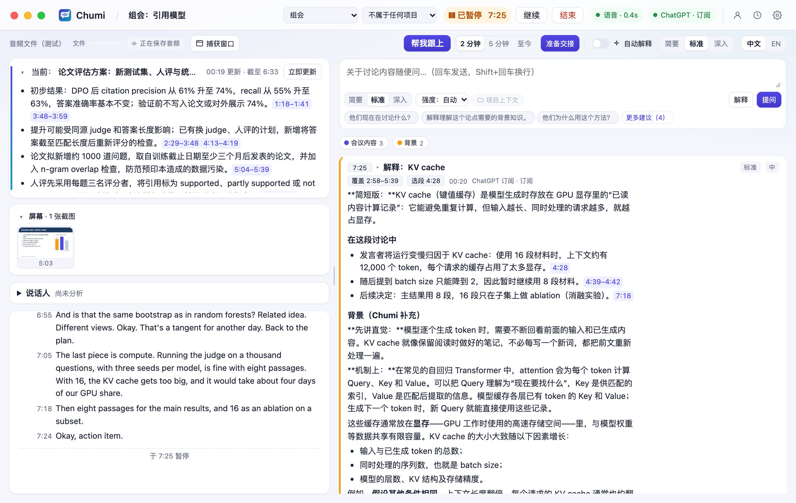</a><br>
      <b>按你的水平解释</b><br>
      <sub>选中 <i>KV cache</i> 这样的术语：直观解释、在本次讨论中的用法和重要性，按你的背景调整，中文或英文回答。</sub><br><sub>&#8199;&#8199;&#8199;&#8199;&#8199;&#8199;&#8199;&#8199;&#8199;&#8199;&#8199;&#8199;&#8199;&#8199;&#8199;&#8199;&#8199;&#8199;&#8199;&#8199;&#8199;&#8199;&#8199;&#8199;&#8199;&#8199;&#8199;&#8199;&#8199;&#8199;&#8199;&#8199;&#8199;&#8199;&#8199;&#8199;&#8199;&#8199;&#8199;&#8199;&#8199;&#8199;&#8199;&#8199;&#8199;&#8199;&#8199;&#8199;&#8199;&#8199;&#8199;&#8199;&#8199;&#8199;&#8199;&#8199;&#8199;&#8199;&#8199;&#8199;&#8199;&#8199;&#8199;&#8199;&#8199;&#8199;&#8199;&#8199;&#8199;&#8199;</sub>
    </td>
    <td width="520" valign="top">
      <a href="docs/assets/screens/zh/window-capture.png">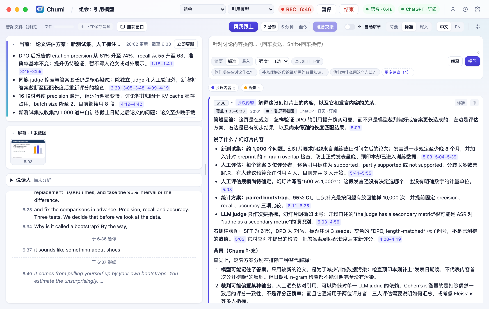</a><br>
      <b>就屏幕上的幻灯片提问</b><br>
      <sub>选择 Zoom 共享屏幕或课程视频。Chumi 每页幻灯片保留一张图，结合画面和实际发言来回答。</sub><br><sub>&#8199;&#8199;&#8199;&#8199;&#8199;&#8199;&#8199;&#8199;&#8199;&#8199;&#8199;&#8199;&#8199;&#8199;&#8199;&#8199;&#8199;&#8199;&#8199;&#8199;&#8199;&#8199;&#8199;&#8199;&#8199;&#8199;&#8199;&#8199;&#8199;&#8199;&#8199;&#8199;&#8199;&#8199;&#8199;&#8199;&#8199;&#8199;&#8199;&#8199;&#8199;&#8199;&#8199;&#8199;&#8199;&#8199;&#8199;&#8199;&#8199;&#8199;&#8199;&#8199;&#8199;&#8199;&#8199;&#8199;&#8199;&#8199;&#8199;&#8199;&#8199;&#8199;&#8199;&#8199;&#8199;&#8199;&#8199;&#8199;&#8199;&#8199;</sub>
    </td>
    <td width="520" valign="top">
      <a href="docs/assets/screens/zh/summary.png">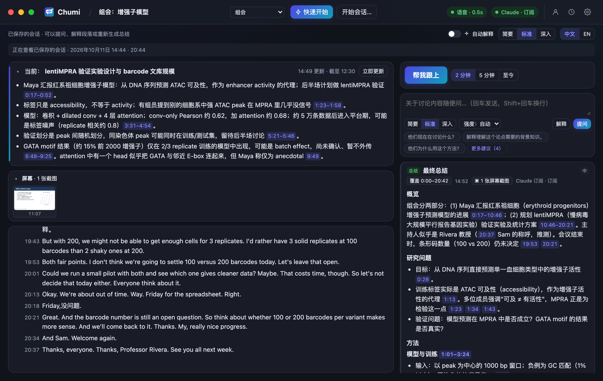</a><br>
      <b>值得信赖的总结</b><br>
      <sub>按会议类型组织。初步结果保持初步，分歧如实保留，负责人只在有人明确说过时才列出。</sub><br><sub>&#8199;&#8199;&#8199;&#8199;&#8199;&#8199;&#8199;&#8199;&#8199;&#8199;&#8199;&#8199;&#8199;&#8199;&#8199;&#8199;&#8199;&#8199;&#8199;&#8199;&#8199;&#8199;&#8199;&#8199;&#8199;&#8199;&#8199;&#8199;&#8199;&#8199;&#8199;&#8199;&#8199;&#8199;&#8199;&#8199;&#8199;&#8199;&#8199;&#8199;&#8199;&#8199;&#8199;&#8199;&#8199;&#8199;&#8199;&#8199;&#8199;&#8199;&#8199;&#8199;&#8199;&#8199;&#8199;&#8199;&#8199;&#8199;&#8199;&#8199;&#8199;&#8199;&#8199;&#8199;&#8199;&#8199;&#8199;&#8199;&#8199;&#8199;</sub>
    </td>
    <td width="520" valign="top">
      <a href="docs/assets/screens/zh/playback.png">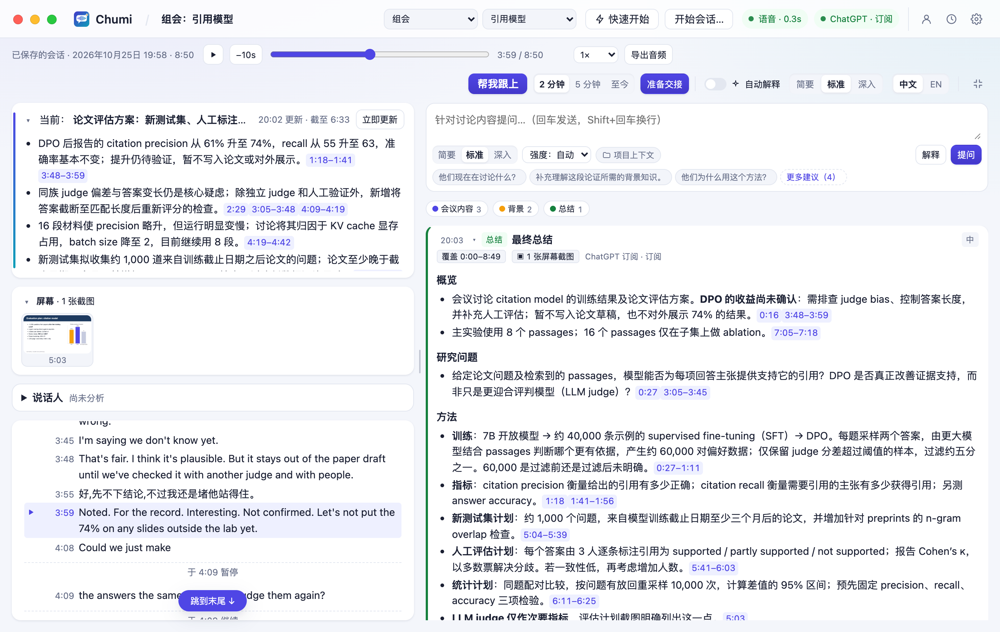</a><br>
      <b>再听一遍</b><br>
      <sub>点击某行旁的 ▶ 从那里回放，正在播放的行会高亮。<b>导出音频</b> 把整场会议存成一个文件。</sub><br><sub>&#8199;&#8199;&#8199;&#8199;&#8199;&#8199;&#8199;&#8199;&#8199;&#8199;&#8199;&#8199;&#8199;&#8199;&#8199;&#8199;&#8199;&#8199;&#8199;&#8199;&#8199;&#8199;&#8199;&#8199;&#8199;&#8199;&#8199;&#8199;&#8199;&#8199;&#8199;&#8199;&#8199;&#8199;&#8199;&#8199;&#8199;&#8199;&#8199;&#8199;&#8199;&#8199;&#8199;&#8199;&#8199;&#8199;&#8199;&#8199;&#8199;&#8199;&#8199;&#8199;&#8199;&#8199;&#8199;&#8199;&#8199;&#8199;&#8199;&#8199;&#8199;&#8199;&#8199;&#8199;&#8199;&#8199;&#8199;&#8199;&#8199;&#8199;</sub>
    </td>
    <td width="520" valign="top">
      <a href="docs/assets/screens/zh/handoff.png">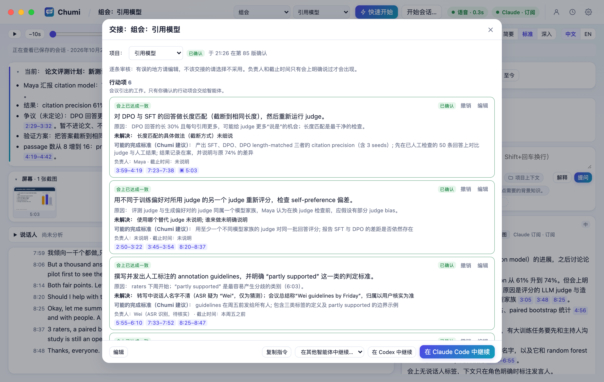</a><br>
      <b>交接，由你审阅</b><br>
      <sub>决定和行动项都附出处、标明来源。逐条确认、修改或不采用，然后<b>继续在</b> Codex app 或 Claude Code 中。</sub><br><sub>&#8199;&#8199;&#8199;&#8199;&#8199;&#8199;&#8199;&#8199;&#8199;&#8199;&#8199;&#8199;&#8199;&#8199;&#8199;&#8199;&#8199;&#8199;&#8199;&#8199;&#8199;&#8199;&#8199;&#8199;&#8199;&#8199;&#8199;&#8199;&#8199;&#8199;&#8199;&#8199;&#8199;&#8199;&#8199;&#8199;&#8199;&#8199;&#8199;&#8199;&#8199;&#8199;&#8199;&#8199;&#8199;&#8199;&#8199;&#8199;&#8199;&#8199;&#8199;&#8199;&#8199;&#8199;&#8199;&#8199;&#8199;&#8199;&#8199;&#8199;&#8199;&#8199;&#8199;&#8199;&#8199;&#8199;&#8199;&#8199;&#8199;&#8199;</sub>
    </td>
    <td width="520" valign="top">
      <a href="docs/assets/screens/zh/project-context.png">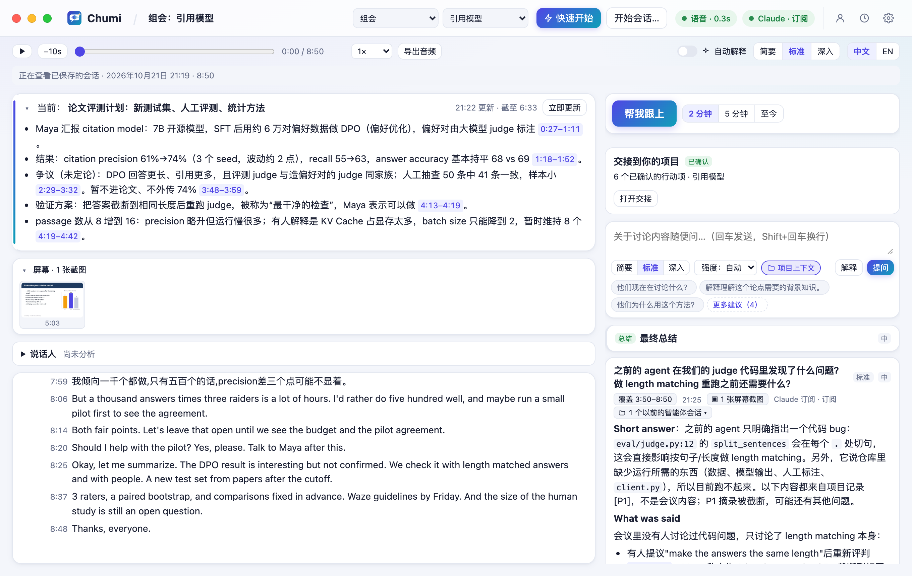</a><br>
      <b>下次开会还记得</b><br>
      <sub>开启<b>项目上下文</b>，回答还会通过 <a href="https://github.com/jzhoulab/mybot">mybot</a> 引用智能体的历史会话，标为 [P1]、[P2]。</sub><br><sub>&#8199;&#8199;&#8199;&#8199;&#8199;&#8199;&#8199;&#8199;&#8199;&#8199;&#8199;&#8199;&#8199;&#8199;&#8199;&#8199;&#8199;&#8199;&#8199;&#8199;&#8199;&#8199;&#8199;&#8199;&#8199;&#8199;&#8199;&#8199;&#8199;&#8199;&#8199;&#8199;&#8199;&#8199;&#8199;&#8199;&#8199;&#8199;&#8199;&#8199;&#8199;&#8199;&#8199;&#8199;&#8199;&#8199;&#8199;&#8199;&#8199;&#8199;&#8199;&#8199;&#8199;&#8199;&#8199;&#8199;&#8199;&#8199;&#8199;&#8199;&#8199;&#8199;&#8199;&#8199;&#8199;&#8199;&#8199;&#8199;&#8199;&#8199;</sub>
    </td>
    <td width="520" valign="top">
      <a href="docs/assets/screens/zh/home.png">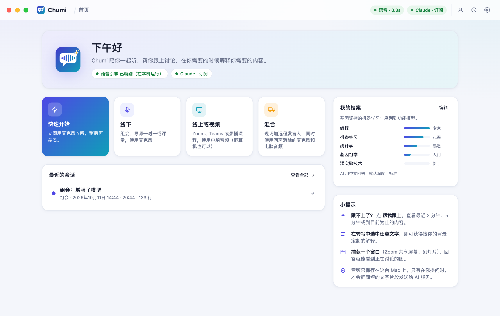</a><br>
      <b>完成初始设置</b><br>
      <sub>首页引导你登录 AI、填写个人背景、授予麦克风权限。之后点 <b>⚡ 快速开始</b>，或在任何应用中按 <b>⌃⌥⌘L</b>。</sub><br><sub>&#8199;&#8199;&#8199;&#8199;&#8199;&#8199;&#8199;&#8199;&#8199;&#8199;&#8199;&#8199;&#8199;&#8199;&#8199;&#8199;&#8199;&#8199;&#8199;&#8199;&#8199;&#8199;&#8199;&#8199;&#8199;&#8199;&#8199;&#8199;&#8199;&#8199;&#8199;&#8199;&#8199;&#8199;&#8199;&#8199;&#8199;&#8199;&#8199;&#8199;&#8199;&#8199;&#8199;&#8199;&#8199;&#8199;&#8199;&#8199;&#8199;&#8199;&#8199;&#8199;&#8199;&#8199;&#8199;&#8199;&#8199;&#8199;&#8199;&#8199;&#8199;&#8199;&#8199;&#8199;&#8199;&#8199;&#8199;&#8199;&#8199;&#8199;</sub>
    </td>
    <td width="520" valign="top">
      <a href="docs/assets/screens/zh/models.png">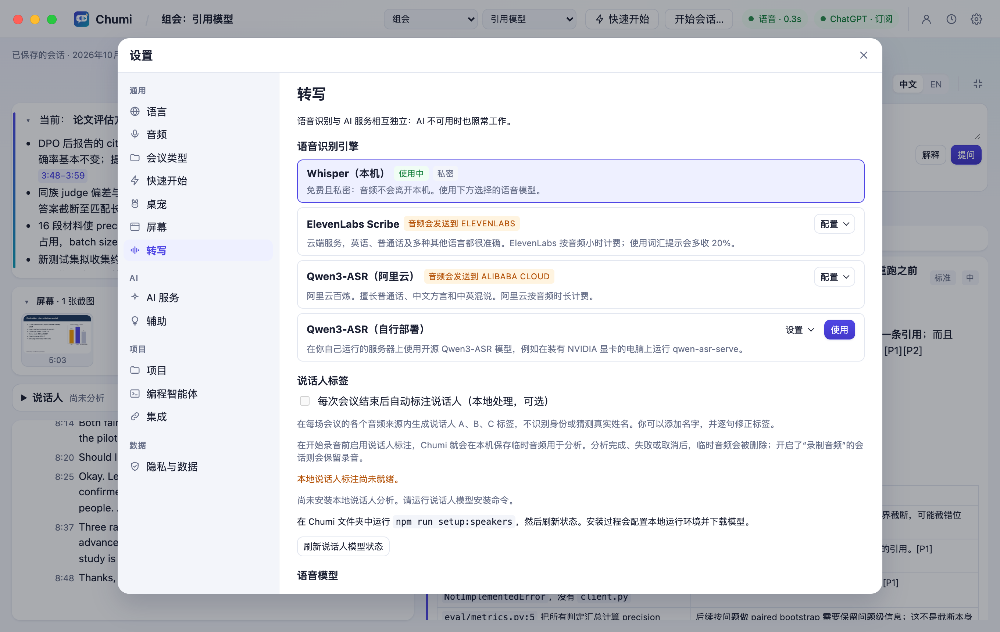</a><br>
      <b>语音留在你的 Mac 上</b><br>
      <sub>本地 whisper.cpp，按你的 Mac 推荐模型。只有你主动选择时，才使用云端语音识别。</sub><br><sub>&#8199;&#8199;&#8199;&#8199;&#8199;&#8199;&#8199;&#8199;&#8199;&#8199;&#8199;&#8199;&#8199;&#8199;&#8199;&#8199;&#8199;&#8199;&#8199;&#8199;&#8199;&#8199;&#8199;&#8199;&#8199;&#8199;&#8199;&#8199;&#8199;&#8199;&#8199;&#8199;&#8199;&#8199;&#8199;&#8199;&#8199;&#8199;&#8199;&#8199;&#8199;&#8199;&#8199;&#8199;&#8199;&#8199;&#8199;&#8199;&#8199;&#8199;&#8199;&#8199;&#8199;&#8199;&#8199;&#8199;&#8199;&#8199;&#8199;&#8199;&#8199;&#8199;&#8199;&#8199;&#8199;&#8199;&#8199;&#8199;&#8199;&#8199;</sub>
    </td>
  </tr>
</table>

<sub>关于截图：本地转写、AI 回答，以及承接后续工作的智能体会话，均来自实际运行。会议素材使用虚构人物和预先编写的对话，由 macOS 文字转语音朗读（中文截图使用双语样例 <a href="samples/llm-meeting/README.md"><code>samples/llm-meeting</code></a>，英文截图使用 <a href="samples/llm-meeting-en/README.md"><code>samples/llm-meeting-en</code></a>），个人背景同样为虚构，所有素材均不含真实会议内容。</sub>

## 安装

**你需要**一台搭载 Apple 芯片的 Mac（macOS 14.4 或更高版本），以及 ChatGPT 或 Claude 订阅。没有订阅的话，配备至少 16 GB 内存的 Mac 也可以运行免费的本地模型。

打开终端，粘贴并运行：

```bash
curl -fsSL https://raw.githubusercontent.com/FakeEnd/chumi/main/scripts/install.sh | bash
```

安装脚本会将 Chumi 下载到 `~/Chumi`，并引导你完成约 5–15 分钟的安装流程：征得同意后安装缺少的工具，配置适合当前 Mac 的本地语音识别模型，构建 Chumi.app，并协助登录 AI 服务。登录信息由官方工具保管，Chumi 不会读取。

首次打开时，首页的 **完成初始设置** 清单会引导你登录 AI 服务、填写个人背景并授予麦克风权限。之后，点击 **⚡ 快速开始**，或在任何应用中按 **⌃⌥⌘L**，即可开始收听；再按一次快捷键即可暂停。

- **手动安装：** `git clone https://github.com/FakeEnd/chumi.git && cd chumi && bash scripts/setup.sh`。[安装指南](docs/install.zh-CN.md)介绍了全部选项（包括用于中国大陆下载加速的 `--mirror`）、权限设置、常见问题和卸载方法。
- **检查安装：** 运行 `npm run doctor`，查看缺失组件及对应的修复命令。
- **在浏览器中使用：** 运行 `npm start`，然后打开[本地页面](http://127.0.0.1:4777)。
- **Windows（桌面预览版）：** 安装包自带麦克风和电脑声音采集、本地语音识别、Codex 和桌宠，并包含共享的录音、交接和项目进度功能。Windows 11 验证记录与构建方法见 [docs/windows.md](docs/windows.md)。
- **iPhone（开发原型）：** [`ios/`](ios/README.zh-CN.md) 里的原生 SwiftUI 工程支持手机录音、本地 Apple Speech 转写，以及配对 Mac 后的会议问答。需要完整 Xcode，尚未完成 iOS 编译和真机验证。见 [iPhone 开发指南](ios/README.zh-CN.md)。

## 选择 AI

在 **设置 → AI 服务** 中选择服务。Chumi 同一时间只使用一个服务，不会自行切换到付费 API。

| AI | 登录方式 | 费用 |
|---|---|---|
| **ChatGPT 订阅**，通过 OpenAI 的 [Codex app-server](https://learn.chatgpt.com/docs/app-server) | `codex login` | 使用套餐内额度；只有你允许后才会使用已购买的点数 |
| **Claude 订阅**，通过未修改的 `claude -p` | `claude auth login` | 使用套餐内额度；需要额外付费时，Chumi 会停止请求 |
| **本地模型**（Ollama、LM Studio） | 无需登录 | 免费，在你的 Mac 上运行；Chumi 会推荐适合内存大小的模型 |
| **兼容 API**（千问、豆包、MiniMax、GLM、自定义） | 密钥存入 macOS 钥匙串 | 按服务商规则计费；默认关闭，需手动开启 |
| **Anthropic API 密钥** | 密钥存入 macOS 钥匙串 | 按请求计费；默认关闭，需手动开启 |

本地模型和兼容 API 的配置方法见[其他模型指南](docs/other-models.zh-CN.md)。各服务的选择依据和官方条款链接见 [AI 服务调研](docs/provider-research.md)。

**语音识别**与 AI 回答独立运行。语音识别默认使用本地 whisper.cpp；在 **设置 → 转写** 中，Chumi 会从七种模型中推荐适合当前 Mac 的一种。你也可以主动选择 ElevenLabs Scribe 或 Qwen3-ASR（阿里云或自行部署），会议音频会发送到所选服务；服务出错时，由本地模型继续转写。详见[转写指南](docs/transcription.md)。

## 隐私

- **音频留在你的 Mac 上**（使用默认的本地语音识别时）。录音只保存在本机，删除会话时一并删除。
- **数据在本地保存：** 会话、转写、回答和个人背景保存在 Mac 上的 SQLite 数据库中，服务仅监听 `127.0.0.1`。
- **发送给 AI 的内容：** 仅包含回答所需的文字，以及你允许发送的幻灯片截图。**设置 → 隐私与数据** 说明了发送的内容和时机。
- **智能体通过只读接口访问：** MCP 服务只提供读取功能。只有你确认的交接项才会作为后续工作，智能体会先提出计划，再进行修改。

## Agent 闭环

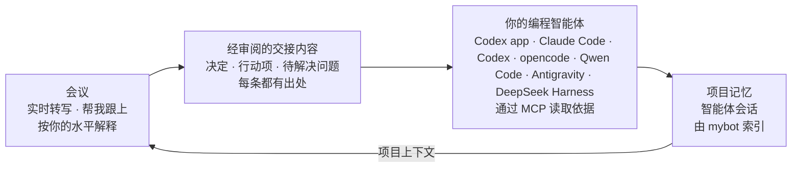

设置步骤：

1. **将会议关联到项目**，也就是你工作的文件夹。可以在开始时选择，也可以之后在顶栏中修改；Chumi 不会自动关联。
2. **选择在哪里继续。** 默认是 Codex app，无需设置：点“继续”会新开一个对话，交接已经填进输入框，你点“发送”之前什么都不会运行。想让终端里的智能体也能读取原始转写，在 **设置 → 编程智能体** 中为它们连接一次；点击 **实际测试智能体读取**，可确认智能体能否访问 Chumi 的只读 MCP 服务。
3. **可选：在本地运行 [mybot](https://github.com/jzhoulab/mybot)**，以使用项目上下文。服务地址可在 **设置 → 集成** 中设置，默认为 `http://127.0.0.1:8788`。只有为当前会议开启 **项目上下文** 后，Chumi 才会检索历史会话。

确认交接后，如果会议内容发生变化，例如重新生成总结或继续录音，Chumi 和智能体都能看到交接内容可能需要重新审阅的提示。详见[智能体接入指南](docs/agents.md)和 [mybot 集成指南](docs/mybot.md)。

## 全部功能

<details>
<summary><b>展开完整列表</b></summary>

**收听**

- 线下讨论使用麦克风；Zoom、Teams 或录播课程使用电脑声音（也支持耳机）；线上线下混合会议可同时采集两者，并过滤重复内容。macOS 还支持麦克风回声消除。
- 支持英语、普通话和中英混合发言。可添加术语和人名提示，提高识别准确率。
- 暂停与继续、全局快速开始快捷键、音量指示，以及清晰的权限设置引导。
- 简洁模式（`⌘⇧.`，Windows 上为 `Ctrl+Shift+.`）隐藏顶栏和工具栏，只留下概览、转写和助手。
- 可选的会后说话人标注（`npm run setup:speakers`）：在本机区分不同说话人，并标为 A/B/C；你可以填写名字、修正标注。见[说话人标注指南](docs/speaker-diarization.md)。
- Chumi.app 的桌宠：工具栏可以开始、暂停或结束会议，帮你跟上、直接提问，还能继续已确认的交接。点不到它的地方照常点，它也不会出现在屏幕共享里。见[桌宠说明](docs/desktop-pet.md)。

**理解**

- 帮我跟上：回顾最近 2 分钟、最近 5 分钟，或从开始到现在的全部讨论。
- 针对选中段落、上下文和前面相关内容提问。
- 解释深度可选 **简要、标准、深入**；支持此设置的 AI 服务还可选择 **推理强度**，从 **低** 到 **最高**。
- 可选的自动背景卡片，以及随讨论更新的概览和话题时间线。
- 回答按时间线排列，标出每次提问时的会议时间。只有最新一条展开，其余折叠成一行标题，点击展开。每个问题标为「会议内容」或「发散提问」。
- 回答会区分 *讲者原话*、*Chumi 补充的背景* 和 *解读与不确定性*。如果讲者提到的幻灯片不在 Chumi 可见的画面中，回答会明确说明。

**记录**

- 会议类型（可在“设置 → 会议类型”中重命名或添加），每种类型有自己的总结风格。
- 历史记录：中英文全文搜索、重新打开、导出为 Markdown 或纯文本、删除。
- 按会话保存录音：各音频来源混合为一条与转写时间对应的音轨，较长的暂停会缩短为一秒的间隔。macOS 导出为 `.m4a`（每小时约 14 MB），Windows 导出为 `.wav`。原始录音按每个音频来源计算，每小时约占 115 MB。
- 转写逐句实时保存。程序意外退出后，可以重新打开会话并继续录音；中断位置会有标记，已录制的音频也会保留。
- 与 [mybot](https://github.com/jzhoulab/mybot) 双向联动：项目上下文可检索智能体的历史会话，已结束的会议也可导出到 mybot 的记忆库中，默认仅本人可见。见 [mybot 集成指南](docs/mybot.md)。

**成本控制**

- 显示计费方式，以及服务商提供的额度信息。检测到订阅套餐内额度耗尽时，会暂停请求。
- 后台任务（概览、自动解释）在支持的服务上使用低推理强度；较长的会议会整理成持续更新的笔记，避免每次都重新发送完整转写。

</details>

<details>
<summary><b>工作原理</b></summary>

```
Chumi.app（Swift 窗口 + macOS 隐私权限身份）
├── chumi-audio   AVAudioEngine 麦克风（含回声消除）· Core Audio process tap 电脑声音
├── chumi-screen  ScreenCaptureKit 窗口截图
├── chumi-hotkey  全局快速开始快捷键
└── Node.js 服务（TypeScript，node:sqlite）
    ├── 语音活动检测分段 → 转写调度 → whisper-server（本地）或你选择的语音服务
    ├── SQLite：会话 · 原始转写 · 中断记录 · AI 输出（与转写分开保存）· 屏幕截图
    ├── 录音：每个音源按时间记录，回放和导出时实时混音
    ├── 助手：帮我跟上 · 问答 · 解释 · 概览 · 自动解释 · 总结 · 交接
    ├── 只读 MCP 服务，供编程智能体使用
    └── AI 服务：Codex app-server │ claude -p │ Anthropic API │ 兼容的本地模型服务 / API
React 界面 ⇄ HTTP + Server-Sent Events（仅 127.0.0.1）
```

</details>

## 开发

```bash
npm run check                                  # 类型检查和单元测试
node scripts/acceptance.ts                     # 端到端：20 分钟样例经过真实 Whisper，AI 用离线替身
node scripts/check-audio.ts system 6 --play    # 验证真实的电脑声音采集（麦克风用 "mic 6"）
npm run build:tools                            # 重新编译窗口截图和快捷键辅助程序
```

<details>
<summary><b>重新生成截图和视频</b></summary>

1. 用 macOS `say` 生成样例会议音频（每段生成约需一分钟）：`node scripts/make-sample.mjs --script samples/llm-meeting-en/script.json`，`samples/llm-meeting` 同理。
2. 准备智能体协作流程（只需一次）：`node scripts/demo-shoot.ts --prepare-agent --project-folder DIR` 会为项目文件夹起草并确认交接内容，同时保留相应的数据文件夹。在 `DIR` 中使用生成的提示词运行 Claude Code（或 Codex），将 Chumi 的 MCP 服务指向保留的数据文件夹，再等待 mybot 索引这次会话。
3. 截图：`node scripts/demo-shoot.ts --project-folder DIR`（加 `--lang zh` 生成 `docs/assets/screens/zh/` 中的中文版），大约使用 15 次 Claude 订阅请求；加 `--provider codex` 改用 ChatGPT 订阅。
4. 现场录屏：`node scripts/record-footage.ts`（加 `--lang zh` 录中文）在回答实时生成时录下真实的窗口和桌宠，存到 `dist/footage/`，会先重新构建网页界面，大约使用 6 次请求（默认用 Codex；加 `--provider claude-cli` 改用 Claude 订阅）。`--only agent --project-folder DIR` 录下继续一份已确认交接的过程（不会真的打开任何程序），并保留数据文件夹，供编程智能体在 `DIR` 中真实运行。
5. 视频：`node scripts/make-video.ts` 渲染 `docs/video/promo.html`；加 `--lang zh` 生成中文版，加 `--speed 1.5` 或 `--speed 2` 生成快剪版。`node scripts/make-pet-video.ts` 渲染桌宠视频（`--lang en` 生成英文版）。两个都需要第 4 步的录屏。之后运行 `bash scripts/make-banner.sh`，重新生成横幅和两张视频卡片，并把卡片做成视频的第一帧。再把四个介绍视频和桌宠视频上传到 GitHub（拖进评论框），把卡片换成新链接：GitHub 会把它们显示成播放器。

</details>

| 路径 | 内容 |
|---|---|
| `server/` | 音频处理、语音识别、录音、助手、AI 服务、MCP 服务、存储 |
| `web/` | React 界面 |
| `native/` | Swift 外壳和辅助程序（[native/README.md](native/README.md)），以及 Windows 桌面应用 |
| `scripts/` | 安装、验收测试、音频检查、截图、视频、样例生成 |
| `samples/` | 虚构会议：`llm-meeting`（截图、视频）和 `lab-meeting`（验收测试） |
| `integrations/mybot/` | mybot 数据源适配器、补丁、安装脚本和测试 |
| `docs/` | 各类指南、[AI 服务调研](docs/provider-research.md)和[验证记录](docs/verification.md) |

## 现状

Chumi 是一个可供日常使用的个人工具。已验证的功能和验证方法，见[验证记录](docs/verification.md)。

**已知限制：** 说话人标注在会后进行，不识别真实身份；受 DRM 保护的视频会截成黑屏；Claude 仅在每次请求后报告用量；macOS 应用使用临时签名，重新编译后需要重新授权。

**下一步：** 支持论文和幻灯片文件作为上下文、实时说话人标注、跨会话术语表、语音播报解释、菜单栏迷你模式，以及每个会话的用量统计。

**相关项目：** [mybot](https://github.com/jzhoulab/mybot)，将 Claude Code 和 Codex 对话汇集为可搜索的记忆库；[nebula-notebook](https://github.com/jzhoulab/nebula-notebook)，为智能体设计的笔记本。

## 许可证

MIT 许可证，详见 [LICENSE](LICENSE)。语音模型从 whisper.cpp 项目（MIT）下载，不包含在本仓库中。
