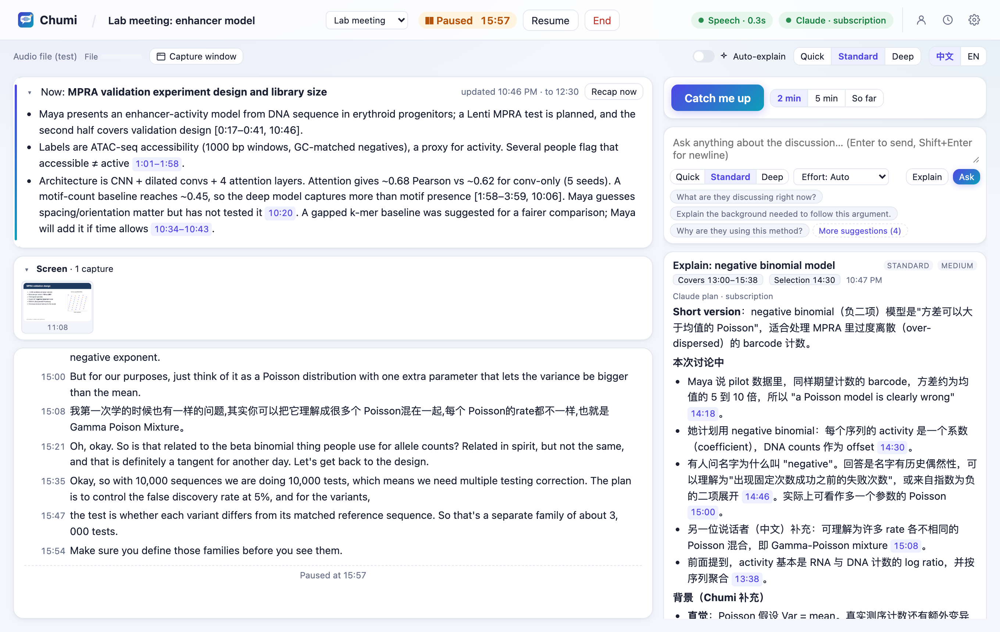

<p align="center">
  <picture>
    <source media="(prefers-color-scheme: dark)" srcset="docs/assets/banner-zh-dark.png">
    <source media="(prefers-color-scheme: light)" srcset="docs/assets/banner-zh-light.png">
    
  </picture>
</p>

<p align="center">
  
  
  
  
  
</p>

<p align="center"><a href="README.md">English</a> · <b>简体中文</b></p>

<p align="center">
  <a href="docs/assets/chumi-promo-zh.mp4"></a><br>
  <sub>▶ <a href="docs/assets/chumi-promo-zh.mp4">观看 60 秒介绍视频</a> · <a href="docs/assets/chumi-promo.mp4">English version</a></sub>
</p>

---

**Chumi 是为学术交流打造的听会助手。** 它在你的 Mac 上实时转写实验室组会、导师一对一、课堂和学术报告，英文、普通话、中英混杂都能听懂。讨论进行时，它随时告诉你讲到了哪里；走神时一键帮你跟上；遇到陌生的方法和术语，按你的背景来解释。每一个回答都能追溯到原话出现的时刻。

科研讨论节奏快，又经常跨领域：做深度学习的人去听湿实验组会，做生物的人去听统计报告，总会在这里漏掉一分钟、那里错过一个词。Chumi 帮你把线索接住。AI 部分使用你已有的 ChatGPT 或 Claude 订阅，音频始终不离开你的电脑。

## 亮点

- **一键跟上进度。** 走神了，或者讲者突然跳到下一个话题？点 **Catch me up（帮我跟上）**，Chumi 会告诉你现在在讨论什么、你错过了哪些要点、和前面的内容有什么联系、当前争论的问题是什么。每个回答都标明它覆盖的转写时间段，会议继续进行时它也不会被冲掉。
- **按你的背景来解释。** 选中一个词或一段话，就能得到深浅合适的背景知识。Chumi 记录你在各个领域的熟悉程度：不会给做机器学习的你讲 transformer，也不会默认你懂某个湿实验技术。深度可选 **Quick / Standard / Deep**，模型的思考力度可选 **Low 到 Max**。
- **讲者原话和 AI 补充分得清清楚楚。** 回答会把*讲者实际说了什么*、*Chumi 补充的背景*和*解读与不确定性*分开写。每个结论都带可点击的 `[m:ss]`，一点就跳到转写里对应的原话。讲者提到看不到的幻灯片时，它会直说"看不到"，而不是瞎猜。
- **还能"看"幻灯片。** 选择 Zoom 共享屏幕、课程视频或幻灯片窗口，Chumi 每换一页就保存一张截图，提问时可以一起发给模型，"解释一下这张图"真的能用。
- **天生双语。** 能转写英文、普通话，以及夹杂英文术语的中文。解释可以用**中文**（保留英文术语）或**英文**，随时切换。
- **值得信赖的总结。** 总结按会议类型组织：组会、导师一对一、课程讲座或 WIP 报告。初步结果不会被写成定论，分歧会被保留，负责人和截止时间只有在真正说过时才会写上。
- **用你已经付费的订阅。** 支持 ChatGPT（通过 Codex）或 Claude（通过 Claude Code），实时显示额度和计费方式。Chumi **绝不会**自己切换到付费 API；额度用完时它会暂停，而不是动用你购买的 credits。
- **隐私安全，崩溃不丢数据。** 语音识别在本机用 whisper.cpp 完成，音频从不离开你的 Mac。转写逐句实时保存；即使程序崩溃，会话也会标记录音中断的位置，可以接着录。
- **突然开始讨论？一个快捷键就行。** 在任何应用里按 **⌃⌥⌘L** 立即开始收听，再按一次暂停。

## 实际效果

**跟丢了？一键帮我跟上。** 下面是一场正在进行的组会，左侧有实时概览和中英混合转写，右侧的"帮我跟上"刚好覆盖最近两分钟，每一条都标注了出处：

<p align="center">
  
</p>

**直接问屏幕上的幻灯片。** 截到的幻灯片会随问题一起发送，回答会把它和讲者实际说的内容对照。在下图中，它还发现幻灯片上的数字和讲者描述的文库规模对不上：

<p align="center">
  
</p>

**中文解释，保留英文术语。** 在转写中选中 *negative binomial*，就能看到直观理解、它在这场讨论里的用法，以及为什么重要，全部按你的统计学水平来写：

<p align="center">
  
</p>

**会议结束，自动生成结构化总结。** 总结包括研究问题、方法、结果（标注为已确立、初步或有争议）、分歧、未决问题和行动项，每一条都能追溯到转写原文。也支持深色模式：

<p align="center">
  
</p>

**一键开始。** 首页提供快速开始，以及线下、线上、混合三种会议预设，并展示最近的会话和你的知识背景概况：

<p align="center">
  
</p>

<sub>以上截图都来自真实运行：本地真实转写，加上 Claude 的真实回答，素材是 <code>samples/lab-meeting</code> 中的合成示例组会。运行 <code>node scripts/demo-shoot.ts</code> 可以重新生成。</sub>

## 与 mybot 联动

[**mybot**](https://github.com/jzhoulab/mybot) 把你所有的 Claude Code 和 Codex 对话汇总成一个本地可搜索的记忆库。打开 Chumi 的导出功能后，**你的会议记录也会加入这个记忆库**。你可以问 mybot："上周导师让我重跑什么？"或者"我们什么时候定下每个变体 200 个 barcode，谁还有疑虑？"，它会给出日期，并链接到会议中原话出现的那一刻。

- 在 Chumi 中：**设置 → Integrations**，打开 *Export finished sessions for mybot*。
- 在 mybot 中：运行一次 `bash integrations/mybot/install.sh ~/Code/mybot`，然后把 `chumi` 加入 `TRAJECTORY_SOURCES`。
- 会议里有其他人说的话，所以**默认只有你自己能查**（`visibility: private`）。要分享给团队成员，需要另外手动开启。

完整的设置步骤、导出格式和隐私说明见 [docs/mybot.md](docs/mybot.md)（英文）。

## 快速开始

**环境要求：** Apple Silicon 芯片的 Mac，macOS 14.4 或更高版本；需要 [Homebrew](https://brew.sh)、Node.js 24 或更高版本，以及 Xcode Command Line Tools（`xcode-select --install`）。

### 1. 安装

```bash
git clone https://github.com/FakeEnd/chumi.git && cd chumi
```

```bash
bash scripts/setup.sh
```

安装脚本会安装 whisper.cpp，下载语音模型（约 875 MB，只下载一次，保存在 `~/Library/Application Support/Chumi/models/`），安装 npm 依赖，并编译 App 和辅助工具。

### 2. 连接你已有的 AI 订阅

二选一即可。账号信息由官方命令行工具保管，Chumi 不会接触。

```bash
codex login
```

上面是 ChatGPT 的方式，登录时选 *Sign in with ChatGPT*。如果用 Claude 订阅，改用：

```bash
claude auth login
```

### 3. 开始收听

```bash
open build/Chumi.app
```

点击 **⚡ Quick start**，或在任何地方按 **⌃⌥⌘L**。第一次使用时，macOS 会询问麦克风和/或系统录音权限。你也可以运行 `npm start`，然后在浏览器打开 http://127.0.0.1:4777。

## 功能一览

**收听**
- 线下讨论用麦克风；Zoom、Teams 或录播课程用电脑声音（戴耳机也可以）；混合会议两者同时开，自带回声消除和重复内容过滤。
- 本地 whisper.cpp large-v3-turbo，在 Metal GPU 上运行，每句约 0.3 秒。灰色的临时文字会原地修正，不会重复出现。
- 支持英文、普通话以及中英混杂。繁体自动转简体，可添加术语和人名提示来提高识别准确率。
- 暂停与继续、快捷键快速开始、音量指示，以及清晰的权限设置引导。

**理解**
- 帮我跟上：最近 2 分钟、最近 5 分钟，或从开头到现在。
- 针对选中段落、上下文和前面相关内容提问。
- 每个问题都可以单独选择解释深度（Quick / Standard / Deep）和思考力度（Auto / Low / Medium / High / Extra high / Max），不会改动你保存的个人背景。
- 可选的自动背景卡片：有冷却时间和打扰次数上限，关闭后迟到的结果会直接丢弃。
- 实时讨论概览和话题时间线，在停顿和换话题时自动更新。
- 窗口截图（ScreenCaptureKit），每页幻灯片保留一张，支持"就这张幻灯片提问"。

**记录**
- 按会议类型生成结构化最终总结：带引用，保留不确定性和分歧，负责人和截止时间只在明确说过时才写。
- 历史记录：中英文全文搜索、重新打开、导出为 Markdown 或纯文本、删除。
- 转写逐句实时保存；录音中断处会被标记，中断的会话可以继续录制。

**可信与成本控制**
- 同一时间只用一个 AI 服务，绝不自动切换到其他服务。
- 实时显示额度和计费方式；包含的额度用完时自动暂停。
- 后台任务（概览、自动解释）用低思考力度运行；长会议使用滚动笔记，不会每次重发整份转写。
- 设置 → Privacy & data 中写明了会发送什么、什么时候发送。

## 工作原理

```
Chumi.app（Swift 窗口 + macOS 隐私权限身份）
├── chumi-audio   AVAudioEngine 麦克风（含回声消除）· Core Audio process tap 电脑声音
├── chumi-screen  ScreenCaptureKit 窗口截图
├── chumi-hotkey  全局快速开始快捷键
└── Node.js 服务（TypeScript，node:sqlite）
    ├── 语音活动检测分段 → 转写调度 → whisper-server（本地、独立进程）
    ├── SQLite：会话 · 原始转写 · 中断记录 · AI 输出（与转写分开保存）· 屏幕截图
    ├── 助手：帮我跟上 · 问答 · 解释 · 概览 · 自动解释 · 总结
    └── AI 服务：Codex app-server（ChatGPT 订阅）│ claude -p（Claude 订阅）│ Anthropic API（可选，付费）
React 界面 ⇄ HTTP + Server-Sent Events（仅 127.0.0.1）
```

| AI 服务 | 登录方式 | 计费 |
|---|---|---|
| ChatGPT 订阅，通过 OpenAI 官方文档中的 [Codex app-server](https://learn.chatgpt.com/docs/app-server) | `codex login` | 使用套餐内额度；只有你同意才会动用购买的 credits |
| Claude 订阅，通过未修改的 `claude -p`（个人使用） | `claude auth login` | 使用套餐的用量限额；出现付费超额时 Chumi 会停止 |
| Anthropic API key | 保存在 macOS 钥匙串 | 按次付费；默认关闭，需手动开启 |

这些选择的依据，以及官方条款链接，见 [docs/provider-research.md](docs/provider-research.md)。

## 开发

```bash
npm run check
```

运行类型检查和单元测试。

```bash
node scripts/acceptance.ts
```

端到端测试：用真实 Whisper 转写 20 分钟示例，AI 部分用离线测试替身。加上 `--provider claude-cli` 就改用真实模型。

```bash
node scripts/check-audio.ts system 6 --play
```

确认能真正采集到电脑声音。把参数换成 `mic 6` 可以测试麦克风。

```bash
node scripts/demo-shoot.ts
```

重新生成 README 截图。`bash scripts/make-banner.sh` 可以重新渲染横幅；`node scripts/make-video.ts`（加 `--lang zh` 生成中文版）会根据 `docs/video/promo.html` 重新渲染介绍视频。

```bash
npm run build:tools
```

只重新编译截图和快捷键辅助工具，不影响 Chumi.app 已获得的权限。

| 路径 | 内容 |
|---|---|
| `server/` | 音频处理、语音识别、助手逻辑、AI 服务接入、存储 |
| `web/` | React 界面 |
| `native/` | Swift App 外壳和辅助工具（[native/README.md](native/README.md)） |
| `scripts/` | 安装、验收测试、音频检查、截图、示例生成 |
| `samples/lab-meeting/` | 合成的双语示例组会，用 `npm run sample` 生成 |
| `integrations/mybot/` | mybot 数据源适配器、补丁、安装脚本和测试（[docs/mybot.md](docs/mybot.md)） |
| `docs/` | [AI 服务调研](docs/provider-research.md)、[验证记录](docs/verification.md)、[mybot 联动](docs/mybot.md)，以及横幅源文件 |

## 相关项目

| 项目 | 简介 |
|---|---|
| [mybot](https://github.com/jzhoulab/mybot) | 编程智能体的连接层：所有 Claude Code 和 Codex 对话汇成一个可搜索的记忆库，并可在团队内共享。Chumi 的会议记录可以作为它的数据源。 |
| [nebula-notebook](https://github.com/jzhoulab/nebula-notebook) | 为智能体而生的笔记本：你和 AI 在同一组 cell 里协作 |

## 现状与计划

Chumi 是一个可以日常使用的个人工具。哪些功能已经验证、怎么验证的，见 [docs/verification.md](docs/verification.md)。

**已知限制：**
- 说话人只区分"麦克风"和"电脑声音"两类。
- 受 DRM 保护的视频截图为黑屏。
- Claude 只在每次请求后才报告用量。
- App 使用临时签名（ad-hoc），重新编译后需要重新授权。

**下一步：** 支持论文和幻灯片文件作为上下文、说话人区分、跨会话术语表、语音播报解释、菜单栏迷你模式，以及每个会话的用量统计。
