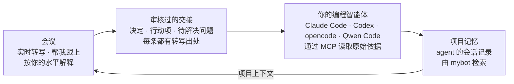

<p align="center">
  <picture>
    <source media="(prefers-color-scheme: dark)" srcset="docs/assets/banner-zh-dark.png">
    <source media="(prefers-color-scheme: light)" srcset="docs/assets/banner-zh-light.png">
    
  </picture>
</p>

<p align="center">
  
  
  
  
  
  <a href="LICENSE"></a>
</p>

<p align="center"><a href="README.md">English</a> · <b>简体中文</b></p>

<p align="center">
  <a href="docs/assets/chumi-promo-zh-1.5x.mp4"></a><br>
  <sub>▶ <a href="docs/assets/chumi-promo-zh-1.5x.mp4">观看 36 秒介绍视频</a> · <a href="docs/assets/chumi-promo-zh-2x.mp4">27 秒快剪版</a> · <a href="docs/assets/chumi-promo-zh.mp4">完整 54 秒版</a> · <a href="docs/assets/chumi-promo-1.5x.mp4">English version</a></sub>
</p>

---

**Chumi 是为学术交流打造的听会助手，还会把会上定下的事交给你的编程智能体接着做。** 它在你的 Mac 上实时转写实验室组会、导师一对一、课堂和学术报告，英文、普通话、中英混杂都能听懂。讨论进行时，它随时告诉你讲到了哪里；走神时一键帮你跟上；遇到陌生的方法和术语，按你的背景来解释。每一个回答都能追溯到原话出现的时刻。

会议结束时，Chumi 不止于一份纪要。你审核一份交接，Claude Code、Codex、opencode 或 Qwen Code 就在你的项目里接着干，并自己去读原始依据。下次开会时，Chumi 还能查到这些 agent 之前做过什么。AI 部分可以使用你已有的 ChatGPT 或 Claude 订阅、本地模型服务或兼容 API，音频始终不离开你的电脑。

## Agent 闭环



1. **听懂会议。** 会议进行中，Chumi 在本机转写，走神时帮你跟上，按你的水平解释术语。
2. **审核交接。** 会后它起草决定、行动项和待解决问题，每条都标注转写出处，并标明是*会上商定*、*仅为建议*还是 *Chumi 提议*。你逐条编辑、确认或不采用，只有确认过的工作才会交出去。
3. **agent 接着干。** 点 **在 Claude Code 中继续**（或 Codex、opencode、Qwen Code），Chumi 在项目文件夹中打开智能体，并带上已确认的工作。智能体通过 Chumi 的本地只读 MCP 服务读取交接、转写原文和截取的幻灯片，先提出计划，等你同意再动手。
4. **下次开会记得之前的事。** 在提问框中打开 **项目上下文**，提问时会通过 [mybot](https://github.com/jzhoulab/mybot) 同时搜索这个项目之前的 Claude Code 和 Codex 会话。回答以 `[P1]`、`[P2]` 引用它们，让你在重新决定之前先知道 agent 已经试过什么。

<p align="center">
  
</p>

<p align="center">
  
</p>

<sub>两张图都来自示例会议的真实运行：真实的本地转写和真实的 Claude 回答。项目上下文引用的，是之前接手这个示例项目交接的 Claude Code 和 Codex 会话。</sub>

## Chumi 和普通转写应用有什么不同

| | 常见的会议转写应用 | Chumi |
|---|---|---|
| **会议进行中** | 一份可以翻看的实时转写 | 帮你跟上、按你的水平解释术语、能看懂屏幕上的幻灯片 |
| **会议结束时** | 一份给人看的总结和待办 | 一份由你审核的交接，之后由编程智能体在项目里接着做 |
| **依据** | 总结就是记录本身 | 每个结论都标注时刻；agent 自己去取原始转写和幻灯片 |
| **AI 补充的内容** | 和纪要混在一起 | 分开写：讲者原话、Chumi 补充的背景、解读 |
| **谁来决定** | AI 生成的待办就是结果 | 每条标明是会上商定、仅为建议还是 Chumi 提议；只有你确认的才算工作 |
| **跨会议** | 每次会议一份纪要 | 会议和 agent 会话在同一个记忆库里，下次开会可以用上 |
| **音频和费用** | 通常在厂商云端处理，需要单独订阅 | 语音在你的 Mac 上识别；AI 用你已有的 ChatGPT 或 Claude 订阅，或本地模型 |

## 亮点

- **会议直接变成工作。** 审核过的交接会交给项目文件夹里的 Claude Code、Codex、opencode 或 Qwen Code，原始依据随时可查。不用粘贴转写，也不用从头给 agent 讲一遍。
- **下次开会知道 agent 做过什么。** 打开 **项目上下文** 后，回答会引用这个项目之前的 agent 会话，和会上的原话放在一起看。
- **一键跟上进度。** 走神了，或者讲者突然跳到下一个话题？点 **Catch me up（帮我跟上）**，Chumi 会告诉你现在在讨论什么、你错过了哪些要点、和前面的内容有什么联系、当前争论的问题是什么。每个回答都标明它覆盖的转写时间段，会议继续进行时它也不会被冲掉。
- **按你的背景来解释。** 选中一个词或一段话，就能得到深浅合适的背景知识。Chumi 记录你在各个领域的熟悉程度：不会给做机器学习的你讲 transformer，也不会默认你懂某个湿实验技术。深度可选 **Quick / Standard / Deep**；支持的服务可选 **Low 到 Max** 思考力度，兼容模型使用服务端默认推理设置。
- **讲者原话和 AI 补充分得清清楚楚。** 回答会把*讲者实际说了什么*、*Chumi 补充的背景*和*解读与不确定性*分开写。每个结论都带可点击的 `[m:ss]`，一点就跳到转写里对应的原话。讲者提到看不到的幻灯片时，它会直说"看不到"，而不是瞎猜。
- **还能"看"幻灯片。** 选择 Zoom 共享屏幕、课程视频或幻灯片窗口，Chumi 每换一页就保存一张截图，提问时可以一起发给模型，"解释一下这张图"真的能用。
- **天生双语。** 能转写英文、普通话，以及夹杂英文术语的中文。解释可以用**中文**（保留英文术语）或**英文**，随时切换。界面本身也有中文和英文两种。
- **值得信赖的总结。** 总结按会议类型组织：组会、导师一对一、课程讲座或 WIP 报告。也可以在 **设置 → 会议类型** 中重命名或添加自己的类型，并为每种类型选择总结风格。初步结果不会被写成定论，分歧会被保留，负责人和截止时间只有在真正说过时才会写上。
- **用你已经付费的订阅。** 支持 ChatGPT（通过 Codex）或 Claude（通过 Claude Code），服务商报告额度时会显示。Chumi **绝不会**自己切换到付费 API；只有你明确允许，才会动用购买的 ChatGPT credits。也可以手动选择本地模型服务或兼容 API；兼容 API 的剩余额度未知。
- **隐私安全，崩溃不丢数据。** 语音识别在本机用 whisper.cpp 完成，音频从不离开你的 Mac。转写逐句实时保存；即使程序崩溃，会话也会标记录音中断的位置，可以接着录。
- **突然开始讨论？一个快捷键就行。** 在任何应用里按 **⌃⌥⌘L** 立即开始收听，再按一次暂停。

## 实际效果

**跟丢了？一键帮我跟上。** 下面是一场正在进行的组会，左侧有实时概览和中英混合转写，右侧的"帮我跟上"刚好覆盖最近两分钟，每一条都标注了出处：

<p align="center">
  
</p>

**直接问屏幕上的幻灯片。** 截到的幻灯片会随问题一起发送，回答会把它和讲者实际说的内容对照。在下图中，它还发现幻灯片上的数字和讲者描述的文库规模对不上：

<p align="center">
  
</p>

**中文解释，保留英文术语。** 在转写中选中 *negative binomial*，就能看到直观理解、它在这场讨论里的用法，以及为什么重要，全部按你的统计学水平来写：

<p align="center">
  
</p>

**会议结束，自动生成结构化总结。** 总结包括研究问题、方法、结果（标注为已确立、初步或有争议）、分歧、未决问题和行动项，每一条都能追溯到转写原文。也支持深色模式：

<p align="center">
  
</p>

**适配你电脑的语音模型。** “设置 → 转写”列出从 Tiny 到 Large v3 的七种模型，按你的硬件推荐一个，并测试当前模型的速度和准确度：

<p align="center">
  
</p>

**一键开始。** 首页提供快速开始，以及线下、线上、混合三种会议预设，并展示最近的会话和你的知识背景概况：

<p align="center">
  
</p>

<sub>以上截图都来自真实运行：本地真实转写，加上 Claude 的真实回答，界面为中文。素材是 <code>samples/lab-meeting</code> 中的合成示例组会：按剧本编写、人物均为虚构、由 macOS 语音朗读，个人档案也是虚构的，没有使用任何真实会议内容。运行 <code>node scripts/demo-shoot.ts --lang zh</code> 可以重新生成。</sub>

## 设置 Agent 闭环

1. **项目。** 把会议分配给项目，也就是你工作的文件夹。可以在开始时选择，也可以之后在顶栏修改。Chumi 不会自动分配。
2. **编程智能体。** 在 **设置 → 编程智能体** 中为每个智能体连接一次。Chumi 会把它的只读 MCP 服务注册到智能体里，**实际测试智能体读取** 可以确认智能体能访问 Chumi。Claude Code 和 Codex 有各自的 **继续** 按钮；opencode 和 Qwen Code 在 **在其他智能体中继续…** 菜单里。
3. **项目上下文（可选）。** 在本机运行 [mybot](https://github.com/jzhoulab/mybot)，并在 **设置 → Integrations** 中确认它的地址（默认 `http://127.0.0.1:8788`）。只有你在某次会议中打开 **项目上下文** 后才会搜索。

如果确认之后会议又有变化，例如重新生成了总结或继续了录音，Chumi 和智能体都会看到交接可能需要重新审核。智能体在它自己的权限提示下工作，Chumi 不会替你把工作标记为完成。设置方法、MCP 工具和隐私说明见 [docs/agents.md](docs/agents.md)；项目上下文见 [docs/mybot.md](docs/mybot.md#project-context-in-questions)。

## 与 mybot 联动

[**mybot**](https://github.com/jzhoulab/mybot) 把你所有的 Claude Code 和 Codex 对话汇总成一个本地可搜索的记忆库。它和 Chumi 是双向的：开会时，**项目上下文** 会向 mybot 查询 agent 之前做过什么；打开 Chumi 的导出功能后，**你的会议记录也会加入这个记忆库**。你可以问 mybot："上周导师让我重跑什么？"或者"我们什么时候定下每个变体 200 个 barcode，谁还有疑虑？"，它会给出日期，并链接到会议中原话出现的那一刻。

- 在 Chumi 中：**设置 → Integrations**，打开 *Export finished sessions for mybot*。
- 在 mybot 中：运行一次 `bash integrations/mybot/install.sh ~/Code/mybot`，然后把 `chumi` 加入 `TRAJECTORY_SOURCES`。
- 会议里有其他人说的话，所以**默认只有你自己能查**（`visibility: private`）。要分享给团队成员，需要另外手动开启。

完整的设置步骤、导出格式和隐私说明见 [docs/mybot.md](docs/mybot.md)（英文）。

## 可选的说话人标注

运行 `npm run setup:speakers`，然后在录音前开启 **设置 → 转写 → 说话人标签**。会议结束后，本地模型将声音分为 A/B/C。展开转写上方的 **说话人** 面板即可命名，点击某一行的标签可以纠正归属。当前标注会进入 AI 上下文、导出文件以及 Claude Code/Codex 读取的会议证据；修改后，旧摘要和已审核交接会提示需要重新检查。

分析使用本地临时音频，在完成、失败、取消或应用重启时删除。开启 **保存原始音频** 才会保留录音供重新分析。标注只是在单次会议、单个音源内对声音的估计，多人混合讲话会保留不确定性。详见[流程与测试说明](docs/speaker-diarization.md)和[模型安装说明](docs/speaker-models.md)。

## 快速开始

**iPhone 开发原型：** 原生 SwiftUI 工程在 [`ios/Chumi.xcodeproj`](ios/Chumi.xcodeproj)，支持手机录音、本地 Apple Speech 转写，以及配对 Mac 后的会议问答。需要完整 Xcode；首次实现尚未完成 iOS 编译和真机验证。安装、配对、调试权限及当前限制见 [iPhone 开发指南](ios/README.zh-CN.md)。

**你需要**一台 Apple Silicon 芯片的 Mac（macOS 14.4 或更高版本），以及 ChatGPT 或 Claude 订阅。没有订阅的话，16 GB 及以上内存的 Mac 也可以运行免费的本地模型。不需要事先安装其他东西。

打开终端，粘贴：

```bash
curl -fsSL https://raw.githubusercontent.com/FakeEnd/chumi/main/scripts/install.sh | bash
```

它会把 Chumi 下载到 `~/Chumi`，引导式安装约需 5–15 分钟：

1. **检查你的 Mac**，缺少 Xcode Command Line Tools、Homebrew 或 Node.js 24 时，先问你再帮你安装。
2. **安装本地语音识别：** whisper.cpp，以及适合你的 Mac 的语音模型（16 GB 及以上内存的 Apple 芯片为 Large v3 Turbo，约 875 MB）。
3. **在你的 Mac 上构建 Chumi.app。**
4. **帮你连接 AI：** 通过 Codex 使用 ChatGPT、通过 Claude Code 使用 Claude，或者使用本地模型。登录信息只留在官方工具里，Chumi 看不到。
5. **全部检查一遍**，然后打开 Chumi。

第一次打开时，首页的 **准备好 Chumi** 清单会带你完成剩下的步骤：AI 登录、你的背景（解释会按它调整深浅）和麦克风权限。然后点 **⚡ 快速开始**，或在任何应用里按 **⌃⌥⌘L**。你也可以在浏览器中使用：运行 `npm start`，然后打开 http://127.0.0.1:4777。

想手动安装？运行 `git clone https://github.com/FakeEnd/chumi.git && cd chumi && bash scripts/setup.sh`。**[安装指南](docs/install.zh-CN.md)** 里有全部选项（包括在中国大陆加速下载的 `--mirror`）、权限说明、常见问题和卸载方法。`npm run doctor` 可以检查现有安装，并给出缺失部分的修复命令。

### 其他模型：本地或 API

提供**千问（Qwen）、豆包（Doubao）、MiniMax、GLM、Ollama、LM Studio** 和**自定义兼容 API** 预设，通过兼容的 Chat Completions 接口调用。预设只提供初始地址，不会自动选择模型，也不代表拥有相应订阅权益。

1. 打开**设置 → AI 服务**，选择**其他模型：本地或 API**。选择 **Ollama** 或 **LM Studio** 后会自动读取本地服务的模型列表，直接选择即可，无需先填写模型 ID。连接不上或没有模型时，会显示安装、启动或下载引导，完成后点击**刷新模型**。远程 API 仍需填写服务商控制台中的准确模型 ID 或部署 ID。
2. 明确启用此配置；远程 API 需要勾选允许使用你的服务商账号发送请求并承担可能的费用。点击**保存模型设置**。各预设分别保存配置；更改密钥或测试前，需要先保存或放弃修改。
3. 按需保存 API 密钥。密钥按**预设和服务地址分别存入 macOS 钥匙串**，不写入设置。可点击**生成简短回答以测试连接**：只发送测试文字，不发送会议内容，但可能产生费用。
4. 保存后，新请求会使用所选模型。读取列表只查询模型信息，不生成回答、不下载模型，也不发送会议内容。服务地址、可选的本地 API 密钥和模型高级选项可在折叠区域中配置。

下载前，本地预设会根据检测到的芯片、总内存、用户目录所在磁盘空间和当前转录模型，显示**适合这台电脑的模型**。可比较具体 Qwen3 量化版本的下载大小和预计运行内存。推荐会为系统、其他应用及 Chumi 转录预留空间，上下文越长，内存估算越高。上下文选项只改变估算值，请在模型管理软件中配置相同长度。这是容量建议，不是速度测试或运行保证；模型服务尚未安装或启动时也能查看。详见[估算依据和来源](docs/local-model-advice.md)。

图片输入默认关闭；确认模型和服务地址支持后再启用，并同时开启“屏幕”设置中的**发送屏幕截图**。结构化输出默认仅通过提示词约束，只有服务端支持时才选择 JSON 对象或 JSON Schema 模式。Chumi 不会向兼容服务发送推理强度设置。

先安装并启动 Ollama 或 LM Studio，然后在 Chumi 中点击**下载推荐模型**。界面显示下载进度，关闭设置面板后任务继续，完成后自动刷新模型列表。Ollama 支持在 Chumi 内取消和重试；LM Studio 0.4+ 使用其原生下载接口，暂停或取消需在 LM Studio 中操作。如果下载后未出现在列表中，请启用 Just-In-Time loading（按需加载），或在 Developer 中加载该模型。下载不会自动选择或加载模型，请在下拉列表中选择后保存设置。

请在模型服务中设置足够的上下文容量，以容纳会议摘录、笔记和回答；Chumi 不会设置服务端的上下文窗口。本地服务也可能向外部转发请求，请检查其配置。兼容模型推理请求不会自动重试或切换服务。API 剩余额度未知，请查看服务商计费控制台和条款，不要默认聊天订阅包含 API 权益。

## 功能一览

**收听**
- 线下讨论用麦克风；Zoom、Teams 或录播课程用电脑声音（戴耳机也可以）；混合会议两者同时开，自带回声消除和重复内容过滤。
- 本地 whisper.cpp，在 Metal GPU 上运行，使用 Large v3 Turbo 时每句约 0.3 秒。灰色的临时文字会原地修正，不会重复出现。
- 七种语音模型可选，从适合旧 Mac 的 Tiny（31 MB）到 Large v3（1 GB）。“设置 → 转写”会按你的硬件推荐模型，可以下载、删除模型，并测试当前模型的速度和准确度。
- 支持英文、普通话以及中英混杂。Whisper 有时会把普通话写成繁体字，Chumi 默认转换为简体（可关闭）。可添加术语和人名提示来提高识别准确率。
- 暂停与继续、快捷键快速开始、音量指示，以及清晰的权限设置引导。

**理解**
- 帮我跟上：最近 2 分钟、最近 5 分钟，或从开头到现在。
- 针对选中段落、上下文和前面相关内容提问。
- 每个问题都可以单独选择解释深度（Quick / Standard / Deep）；支持的服务可选思考力度（Auto / Low / Medium / High / Extra high / Max），兼容模型使用服务端默认设置。这些选项不会改动你保存的个人背景。
- 可选的自动背景卡片：有冷却时间和打扰次数上限，关闭后迟到的结果会直接丢弃。
- 实时讨论概览和话题时间线，在停顿和换话题时自动更新。
- 窗口截图（ScreenCaptureKit），每页幻灯片保留一张，支持"就这张幻灯片提问"。

**接着工作**
- 从转写起草交接：决定、行动项和待解决问题，每条都有出处，并标明会上商定、仅为建议或 Chumi 提议。交出去之前由你逐条审核。
- **在 Claude Code、Codex、opencode 或 Qwen Code 中继续**：智能体在项目文件夹中打开并带上已确认的工作，通过 Chumi 的只读 MCP 服务读取交接、原始转写和幻灯片。
- 时效检查：确认之后会议如有变化，你和智能体都会看到变化了什么。
- 提问时的 **项目上下文**：通过 mybot 找到项目文件夹中之前的 agent 会话，并以 `[P1]` 引用。

**记录**
- 按会议类型生成结构化最终总结：带引用，保留不确定性和分歧，负责人和截止时间只在明确说过时才写。
- 历史记录：中英文全文搜索、重新打开、导出为 Markdown 或纯文本、删除。
- 转写逐句实时保存；录音中断处会被标记，中断的会话可以继续录制。

**可信与成本控制**
- 同一时间只用一个 AI 服务，绝不自动切换到其他服务。
- 显示计费方式，服务商报告额度时也会显示；订阅接入检测到套餐内额度用完时会暂停。兼容 API 的剩余额度未知。
- 后台任务（概览、自动解释）在支持的服务上使用低思考力度，兼容模型使用服务端默认设置；长会议使用滚动笔记，不会每次重发整份转写。
- 设置 → Privacy & data 中写明了会发送什么、什么时候发送。

## 工作原理

```
Chumi.app（Swift 窗口 + macOS 隐私权限身份）
├── chumi-audio   AVAudioEngine 麦克风（含回声消除）· Core Audio process tap 电脑声音
├── chumi-screen  ScreenCaptureKit 窗口截图
├── chumi-hotkey  全局快速开始快捷键
└── Node.js 服务（TypeScript，node:sqlite）
    ├── 语音活动检测分段 → 转写调度 → whisper-server（本地、独立进程）
    ├── SQLite：会话 · 原始转写 · 中断记录 · AI 输出（与转写分开保存）· 屏幕截图
    ├── 助手：帮我跟上 · 问答 · 解释 · 概览 · 自动解释 · 总结
    └── AI 服务：Codex app-server │ claude -p │ Anthropic API │ 兼容的本地模型服务 / API
React 界面 ⇄ HTTP + Server-Sent Events（仅 127.0.0.1）
```

| AI 服务 | 登录方式 | 计费 |
|---|---|---|
| ChatGPT 订阅，通过 OpenAI 官方文档中的 [Codex app-server](https://learn.chatgpt.com/docs/app-server) | `codex login` | 使用套餐内额度；只有你同意才会动用购买的 credits |
| Claude 订阅，通过未修改的 `claude -p`（个人使用） | `claude auth login` | 使用套餐的用量限额；出现付费超额时 Chumi 会停止 |
| Anthropic API key | 保存在 macOS 钥匙串 | 按次付费；默认关闭，需手动开启 |
| 兼容 API 或本地模型服务 | 按需将密钥按预设和服务地址分别存入 macOS 钥匙串 | 远程 API 需明确启用，按服务商规则计费，剩余额度未知；本地运行环境单独管理 |

这些选择的依据，以及官方条款链接，见 [docs/provider-research.md](docs/provider-research.md)。

## 开发

```bash
npm run check
```

运行类型检查和单元测试。兼容模型接入使用模拟接口测试，尚未验证真实服务商模型的回答质量。

```bash
node scripts/acceptance.ts
```

端到端测试：用真实 Whisper 转写 20 分钟示例，AI 部分用离线测试替身。加上 `--provider claude-cli` 就改用真实模型。

```bash
node scripts/check-audio.ts system 6 --play
```

确认能真正采集到电脑声音。把参数换成 `mic 6` 可以测试麦克风。

```bash
node scripts/demo-shoot.ts
```

重新生成英文 README 截图；加 `--lang zh` 生成 `docs/assets/screens/zh/` 中的中文截图。Agent 闭环的两张截图还需要 `--project-folder DIR`：一个已经由 Claude Code 或 Codex 接手过示例会议交接的项目文件夹，并且 mybot 正在运行（加 `--only agent` 只拍这两张）。`bash scripts/make-banner.sh` 可以重新渲染横幅；`node scripts/make-video.ts`（加 `--lang zh` 生成中文版，加 `--speed 1.5` 或 `--speed 2` 生成快剪版）会根据 `docs/video/promo.html` 重新渲染介绍视频。

```bash
npm run build:tools
```

只重新编译截图和快捷键辅助工具，不影响 Chumi.app 已获得的权限。

| 路径 | 内容 |
|---|---|
| `server/` | 音频处理、语音识别、助手逻辑、AI 服务接入、存储 |
| `web/` | React 界面 |
| `native/` | Swift App 外壳和辅助工具（[native/README.md](native/README.md)） |
| `scripts/` | 安装、验收测试、音频检查、截图、示例生成 |
| `samples/lab-meeting/` | 合成的双语示例组会，用 `npm run sample` 生成 |
| `integrations/mybot/` | mybot 数据源适配器、补丁、安装脚本和测试（[docs/mybot.md](docs/mybot.md)） |
| `docs/` | [AI 服务调研](docs/provider-research.md)、[验证记录](docs/verification.md)、[mybot 联动](docs/mybot.md)，以及横幅源文件 |

## 相关项目

| 项目 | 简介 |
|---|---|
| [mybot](https://github.com/jzhoulab/mybot) | 编程智能体的连接层：所有 Claude Code 和 Codex 对话汇成一个可搜索的记忆库，并可在团队内共享。Chumi 的会议记录可以作为它的数据源，Chumi 的项目上下文也从它读取。 |
| [nebula-notebook](https://github.com/jzhoulab/nebula-notebook) | 为智能体而生的笔记本：你和 AI 在同一组 cell 里协作 |

## 现状与计划

Chumi 是一个可以日常使用的个人工具。哪些功能已经验证、怎么验证的，见 [docs/verification.md](docs/verification.md)。

**已知限制：**
- 可选的说话人标注在会议结束后运行，支持手动命名和纠正；不会自动识别真实身份或跨音源匹配同一个人。实时转写仍按音源区分。
- 受 DRM 保护的视频截图为黑屏。
- Claude 只在每次请求后才报告用量。
- App 使用临时签名（ad-hoc），重新编译后需要重新授权。

**下一步：** 支持论文和幻灯片文件作为上下文、实时说话人标注、跨会话术语表、语音播报解释、菜单栏迷你模式，以及每个会话的用量统计。

## 许可证

MIT 许可证，详见 [LICENSE](LICENSE)。语音模型从 whisper.cpp 项目（MIT）下载，不包含在本仓库中。
