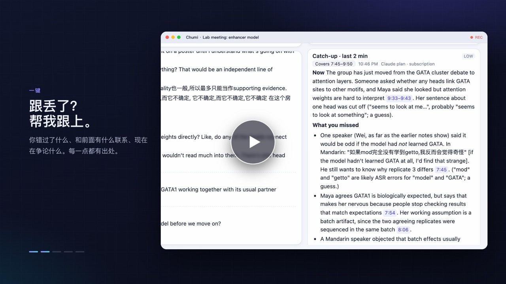
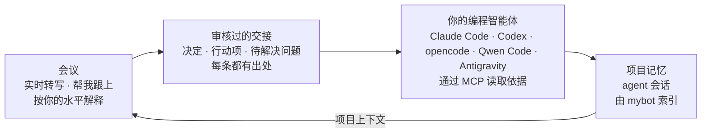

<p align="center">
  <picture>
    <source media="(prefers-color-scheme: dark)" srcset="docs/assets/banner-zh-dark.png">
    <source media="(prefers-color-scheme: light)" srcset="docs/assets/banner-zh-light.png">
    
  </picture>
</p>

<p align="center">
  
  
  
  
  
  <a href="LICENSE"></a>
</p>

<p align="center"><a href="README.md">English</a> · <b>简体中文</b></p>

<p align="center">
  <!-- 封面放在播放器外：GitHub 会移除视频的 poster 属性和内部的备用内容。 -->
  <a href="https://github.com/user-attachments/assets/65b6bba9-4126-404c-a0d7-d1037f99f8bc"></a>
</p>
<p align="center"><sub>▶ <a href="https://github.com/user-attachments/assets/65b6bba9-4126-404c-a0d7-d1037f99f8bc">观看 59 秒介绍视频（有背景音乐）</a> · <a href="README.md">English version</a> · 播放器空白或卡住？<a href="docs/assets/chumi-promo-zh.mp4?raw=1">下载 MP4</a> · 快剪版下载：<a href="docs/assets/chumi-promo-zh-1.5x.mp4?raw=1">40 秒</a>、<a href="docs/assets/chumi-promo-zh-2x.mp4?raw=1">30 秒</a></sub></p>

<details>
<summary>在 GitHub 页面内播放</summary>

<!-- 附件地址单独成行，GitHub 才能生成原生播放器。 -->

https://github.com/user-attachments/assets/65b6bba9-4126-404c-a0d7-d1037f99f8bc

</details>

---

**Chumi 陪你听学术会议，帮你补上没听懂的部分，再把会上定下的事交给你的编程智能体接着做。**

它在你的 Mac 上转写实验室组会、导师一对一、课堂和学术报告，英文、普通话、中英混杂都能听懂。

- **会议进行中：** 一键跟上进度，按你的背景解释术语，还能就屏幕上的幻灯片提问。每个回答都能追溯到原话出现的时刻。
- **会议结束后：** 看一份结构化总结，从任意一行回放录音，审核一份决定和行动项的交接。
- **在你的项目里：** Claude Code、Codex、opencode、Qwen Code 或 Antigravity 接着干，通过 Chumi 的 MCP 服务自己去读原始依据。
- **下次开会：** 回答可以用上这些 agent 之前做过的事。

AI 部分用你已有的 ChatGPT 或 Claude 订阅，也可以用本地模型。默认情况下，音频不离开你的 Mac。

**目录：** [实际效果](#实际效果) · [安装](#安装) · [选择 AI](#选择-ai) · [隐私](#隐私) · [Agent 闭环](#agent-闭环) · [全部功能](#全部功能) · [开发](#开发)

## 实际效果

截图来自一次真实运行，素材是一场虚构的 NLP 组会：Maya 介绍一个用 DPO 训练、回答时要标注出处的 7B 模型，大家争论它的提升是真的，还是 LLM judge 的偏差。见[关于截图](#关于截图)。

### 跟丢了？帮我跟上

点一下，就知道现在在讨论什么、你错过了什么、正在争论什么问题。卡片标明它覆盖的是哪一段转写，每一点都链接到原话。

<p align="center">
  
</p>

### 按你的水平解释

选中 *KV cache* 这样的术语，就能看到直观理解、它在这次讨论里怎么用、为什么重要。Chumi 记录你在各个领域的熟悉程度，所以给刚接触 GPU 的语言学背景同学的解释，和给系统工程师的不一样。解释可以用中文（保留英文术语）或英文。

<p align="center">
  
</p>

### 就屏幕上的幻灯片提问

选择 Zoom 共享屏幕、课程视频或幻灯片窗口。Chumi 每页保留一张截图，提问时一起发给模型，回答会把它和实际说过的话对照着看。

<p align="center">
  
</p>

### 值得信赖的总结

会议结束后，总结会按会议类型组织（组会、导师一对一、课程、WIP 报告）。初步结果不会被写成定论，分歧会被保留，负责人和截止时间只有在真正说过时才会写上。

<p align="center">
  
</p>

### 再听一遍

每次会话默认在你的 Mac 上录音，开始时取消勾选 **录制音频** 即可不录。打开保存的会话后，点某一行旁边的 ▶ 就从那里播放，正在播放的那一行会高亮；**导出音频** 会把整场会议存成一个文件。

<p align="center">
  
</p>

### 交给你的编程智能体

Chumi 起草决定、行动项和待解决问题，每条都有出处，并标明 *会上商定*、*仅为建议* 或 *Chumi 提议*。每一条由你确认、修改或拒绝。**在 Claude Code 中继续**（或其他 agent）会在项目文件夹中打开，只带上你确认过的工作。

<p align="center">
  
</p>

### 下次开会还记得

在提问框打开 **项目上下文**，提问时还会通过 [mybot](https://github.com/jzhoulab/mybot) 检索这个项目之前的 Claude Code 和 Codex 会话。回答以 `[P1]`、`[P2]` 引用它们，和会上的原话放在一起看。

<p align="center">
  
</p>

#### 关于截图

截图来自真实运行：真实的本地转写、真实的 Claude 回答，以及一次真实接手交接的 Claude Code 会话。会议是一份虚构人物的剧本，由 macOS 文字转语音朗读（中文截图用双语的 [`samples/llm-meeting`](samples/llm-meeting/README.md)，英文截图用 [`samples/llm-meeting-en`](samples/llm-meeting-en/README.md)），个人背景也是虚构的，没有任何内容来自真实会议。重新生成的方法见[开发](#开发)。

## 安装

**你需要**一台 Apple Silicon 芯片的 Mac（macOS 14.4 或更高版本），以及 ChatGPT 或 Claude 订阅。没有订阅的话，16 GB 及以上内存的 Mac 也可以运行免费的本地模型。

打开终端，粘贴：

```bash
curl -fsSL https://raw.githubusercontent.com/FakeEnd/chumi/main/scripts/install.sh | bash
```

它会把 Chumi 下载到 `~/Chumi`，引导式安装约需 5–15 分钟：先问你再安装缺少的工具，配置适合你的 Mac 的本地语音识别模型，构建 Chumi.app，并帮你登录 AI。登录信息只留在官方工具里，Chumi 看不到。

第一次打开时，首页的 **准备好 Chumi** 清单会带你完成剩下的步骤：AI 登录、你的背景和麦克风权限。然后点 **⚡ 快速开始**，或在任何应用里按 **⌃⌥⌘L**，再按一次暂停。

<p align="center">
  
</p>

- **手动安装：** `git clone https://github.com/FakeEnd/chumi.git && cd chumi && bash scripts/setup.sh`。[安装指南](docs/install.zh-CN.md)里有全部选项（包括在中国大陆加速下载的 `--mirror`）、权限说明、常见问题和卸载方法。
- **检查安装：** `npm run doctor` 会给出缺失部分的修复命令。
- **在浏览器中使用：** 运行 `npm start`，然后打开 http://127.0.0.1:4777。
- **Windows（桌面预览版）：** 安装包自带麦克风和电脑声音采集、本地语音识别和 Codex，已在 Windows 11 上通过真实的端到端验证。见 [docs/windows.md](docs/windows.md)。

## 选择 AI

在 **设置 → AI 服务** 中选择。Chumi 同一时间只用一个，绝不会自己切换到付费 API。

| AI | 登录方式 | 费用 |
|---|---|---|
| **ChatGPT 订阅**，通过 OpenAI 的 [Codex app-server](https://learn.chatgpt.com/docs/app-server) | `codex login` | 使用套餐内额度；只有你同意才会动用购买的 credits |
| **Claude 订阅**，通过未修改的 `claude -p` | `claude auth login` | 使用套餐的用量限额；出现付费超额时 Chumi 会停止 |
| **本地模型**（Ollama、LM Studio） | 无需登录 | 免费，在你的 Mac 上运行；Chumi 会推荐适合内存大小的模型 |
| **兼容 API**（千问、豆包、MiniMax、GLM、自定义） | 密钥存入 macOS 钥匙串 | 按服务商规则计费；默认关闭，需手动开启 |
| **Anthropic API key** | 密钥存入 macOS 钥匙串 | 按次付费；默认关闭，需手动开启 |

本地模型和兼容 API 的配置见 [docs/other-models.zh-CN.md](docs/other-models.zh-CN.md)。这些选择的依据和官方条款链接见 [docs/provider-research.md](docs/provider-research.md)。

**语音识别**和 AI 是分开的。默认用本地 whisper.cpp，“设置 → 转写”会从七种模型中推荐适合你的 Mac 的一种。ElevenLabs Scribe 和 Qwen3-ASR（阿里云或自行部署）是需要主动选择的替代方案，会把会议音频发出本机；服务出错时由本地模型接手。见 [docs/transcription.md](docs/transcription.md)。

<p align="center">
  
</p>

## 隐私

- **音频留在你的 Mac 上**（使用默认的本地语音识别时）。录音只保存在本机，删除会话时一并删除。
- **一切都在本地：** 会话、转写、回答和个人背景保存在你 Mac 上的 SQLite 数据库中，服务只监听 127.0.0.1。
- **发给 AI 的**只是它需要的文字（以及你开启后的幻灯片截图）。“设置 → Privacy & data”写明了会发送什么、什么时候发送。
- **Agent 只能读：** MCP 服务是只读的，只有你确认的交接项才算工作，agent 动手之前会先给出计划。

## Agent 闭环



设置步骤：

1. **把会议归到一个项目**，也就是你工作的文件夹。开始时选择，或之后在顶栏中修改。不会自动归类。
2. **连接编程智能体**：在 **设置 → 编程智能体** 中逐个连接一次。Chumi 会注册它的只读 MCP 服务，**实际测试智能体读取** 可以确认 agent 能连上。
3. **可选：在本地运行 [mybot](https://github.com/jzhoulab/mybot)** 来使用项目上下文。地址在 **设置 → 集成** 中（默认 `http://127.0.0.1:8788`）。只有你为某场会议打开项目上下文后才会检索。

确认之后如果会议有变化（重新生成了总结、继续录了音），Chumi 和 agent 都会看到交接可能需要重新检查。详见 [docs/agents.md](docs/agents.md) 和 [docs/mybot.md](docs/mybot.md)。

## 全部功能

**收听**
- 线下讨论用麦克风；Zoom、Teams 或录播课程用电脑声音（戴耳机也可以）；混合会议两者同时开，自带回声消除和重复内容过滤。
- 支持英文、普通话以及中英混杂。可添加术语和人名提示来提高识别准确率。
- 暂停与继续、全局快速开始快捷键、音量指示，以及清晰的权限设置引导。
- 可选的会后说话人标注（`npm run setup:speakers`）：在本地把声音分为 A/B/C，由你命名和纠正。见 [docs/speaker-diarization.md](docs/speaker-diarization.md)。

**理解**
- 帮我跟上：最近 2 分钟、最近 5 分钟，或从开头到现在。
- 针对选中段落、上下文和前面相关内容提问。
- 解释深度（Quick / Standard / Deep），支持的服务还可选思考力度（Low 到 Max）。
- 可选的自动背景卡片，以及随讨论更新的概览和话题时间线。
- 回答按时间线排列，标出每次提问时的会议时间。只有最新一条展开，其余折叠成一行标题，点击展开。每个问题标为「会议内容」或「发散提问」。
- 回答把 *讲者原话*、*Chumi 补充的背景* 和 *解读与不确定性* 分开写。讲者提到看不到的幻灯片时，它会直说。

**记录**
- 会议类型（可在“设置 → 会议类型”中重命名或添加），每种类型有自己的总结风格。
- 历史记录：中英文全文搜索、重新打开、导出为 Markdown 或纯文本、删除。
- 按会话录音：所有音源混成一条按转写时间排列的音轨，较长的暂停缩短为一秒的间隔。导出时 macOS 上得到一个 `.m4a`（每小时约 14 MB），Windows 上得到 `.wav`。原始录音每个音源每小时约 115 MB。
- 转写逐句实时保存。程序崩溃后，会话会带着中断标记重新打开，已录制的音频也会保留，可以接着录。
- 与 [mybot](https://github.com/jzhoulab/mybot) 双向联动：项目上下文读取 agent 会话，结束的会议也可以导出到 mybot 的记忆中（默认仅本人可见）。见 [docs/mybot.md](docs/mybot.md)。

**成本控制**
- 显示计费方式，服务商报告额度时也会显示；订阅接入检测到套餐内额度用完时会暂停。
- 后台任务（概览、自动解释）在支持的服务上使用低思考力度；长会议使用滚动笔记，不会每次重发整份转写。

<details>
<summary><b>工作原理</b></summary>

```
Chumi.app（Swift 窗口 + macOS 隐私权限身份）
├── chumi-audio   AVAudioEngine 麦克风（含回声消除）· Core Audio process tap 电脑声音
├── chumi-screen  ScreenCaptureKit 窗口截图
├── chumi-hotkey  全局快速开始快捷键
└── Node.js 服务（TypeScript，node:sqlite）
    ├── 语音活动检测分段 → 转写调度 → whisper-server（本地）或你选择的语音服务
    ├── SQLite：会话 · 原始转写 · 中断记录 · AI 输出（与转写分开保存）· 屏幕截图
    ├── 录音：每个音源按时间记录，回放和导出时实时混音
    ├── 助手：帮我跟上 · 问答 · 解释 · 概览 · 自动解释 · 总结 · 交接
    ├── 只读 MCP 服务，供编程智能体使用
    └── AI 服务：Codex app-server │ claude -p │ Anthropic API │ 兼容的本地模型服务 / API
React 界面 ⇄ HTTP + Server-Sent Events（仅 127.0.0.1）
```

</details>

## 开发

```bash
npm run check                                  # 类型检查和单元测试
node scripts/acceptance.ts                     # 端到端：20 分钟样例经过真实 Whisper，AI 用离线替身
node scripts/check-audio.ts system 6 --play    # 验证真实的电脑声音采集（麦克风用 "mic 6"）
npm run build:tools                            # 重新编译窗口截图和快捷键辅助程序
```

<details>
<summary><b>重新生成截图和视频</b></summary>

1. 用 macOS `say` 生成样例会议（每个约一分钟）：`node scripts/make-sample.mjs --script samples/llm-meeting-en/script.json`，`samples/llm-meeting` 同理。
2. Agent 闭环（只需一次）：`node scripts/demo-shoot.ts --prepare-agent --project-folder DIR` 会为项目文件夹起草并确认一份交接，并保留它的数据文件夹。在 `DIR` 中用这份提示运行 Claude Code（或 Codex），让 Chumi 的 MCP 服务指向保留的数据文件夹，再等 mybot 索引这次会话。
3. 截图：`node scripts/demo-shoot.ts --project-folder DIR`（加 `--lang zh` 生成 `docs/assets/screens/zh/` 中的中文版），大约使用 15 次 Claude 订阅请求。
4. 视频：`node scripts/make-video.ts` 渲染 `docs/video/promo.html`；加 `--lang zh` 生成中文版，加 `--speed 1.5` 或 `--speed 2` 生成快剪版。`bash scripts/make-banner.sh` 重新生成横幅。

</details>

| 路径 | 内容 |
|---|---|
| `server/` | 音频处理、语音识别、录音、助手、AI 服务、MCP 服务、存储 |
| `web/` | React 界面 |
| `native/` | Swift 外壳和辅助程序（[native/README.md](native/README.md)），以及 Windows 桌面应用 |
| `scripts/` | 安装、验收测试、音频检查、截图、视频、样例生成 |
| `samples/` | 虚构会议：`llm-meeting`（截图、视频）和 `lab-meeting`（验收测试） |
| `integrations/mybot/` | mybot 数据源适配器、补丁、安装脚本和测试 |
| `docs/` | 各类指南、[AI 服务调研](docs/provider-research.md)和[验证记录](docs/verification.md) |

## 现状

Chumi 是一个可以日常使用的个人工具。哪些功能已经验证、怎么验证的，见 [docs/verification.md](docs/verification.md)。

**已知限制：** 说话人标注在会后运行，不识别真实身份；受 DRM 保护的视频截图为黑屏；Claude 只在每次请求后才报告用量；App 使用临时签名，重新编译后需要重新授权。

**下一步：** 支持论文和幻灯片文件作为上下文、实时说话人标注、跨会话术语表、语音播报解释、菜单栏迷你模式，以及每个会话的用量统计。

**相关项目：** [mybot](https://github.com/jzhoulab/mybot)，把你所有 Claude Code 和 Codex 对话汇成一个可搜索的记忆；[nebula-notebook](https://github.com/jzhoulab/nebula-notebook)，一个为 agent 设计的笔记本。

## 许可证

MIT 许可证，详见 [LICENSE](LICENSE)。语音模型从 whisper.cpp 项目（MIT）下载，不包含在本仓库中。
